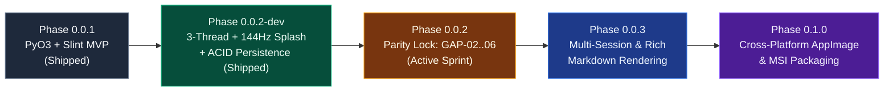

<h1>📋 Changelog, Active Issues &amp; Strategic Roadmap</h1>

  
  
  

  <em>Unified engineering ledger tracking shipped releases, active parity issues, and the multi-phase development roadmap for <strong>Cold Wind AI Desktop GUI</strong>.</em>

---

## 🔥 Active Sprint & Open Engineering Issues (`Phase 0.0.2`)

> [!IMPORTANT]
> **Live Codebase Audit:** Before adding new UI features, `Phase 0.0.2` closes the remaining 5 parity gaps identified in [`reports/parity-audits/01-slint-gui-architecture-gap-audit.md`](./reports/parity-audits/01-slint-gui-architecture-gap-audit.md).

| Issue ID | Priority | Title & Root Cause | Target Files | Status |
| :--- | :---: | :--- | :--- | :---: |
| **`GAP-04`** | `Critical` | **UI Thread 0 Blocking Send & Duplicate Swap Panic:** `on_send_message` executes a blocking `state_sender.send(...)` on `sync_channel(1)` without an `is_generating` lock and calls `derive_swap_file().unwrap()`. | `src/main.rs` `ui/app-window.slint` | `[ ] Open` |
| **`GAP-02`** | `Major` | **Stubbed Slash Command Fast-Paths:** `/clear` (session state reset) and `/exit` / `/quit` (graceful shutdown) fast-paths remain commented/stubbed in the runtime facade. | `src/slint_py_engine.rs` `src/main.rs` | `[ ] Open` |
| **`GAP-03`** | `Critical` | **In-Flight Turn Failure Masking:** Boot failures render `AppState::Failed`, but `Err(_err)` inside `SlintRuntime::process_ticket` in `src/main.rs` lacks a red error diagnostics bubble. | `src/main.rs` `ui/chat_bubbles/` | `[ ] Open` |
| **`GAP-05`** | `Medium` | **Unbound Tool Registry (`TOOL_INFO_LIST`):** Registered Python tools are cached in `OnceLock<Vec<ToolMetadata>>` at boot but not yet exposed to a Slint Tools Drawer. | `src/slint_py_engine.rs` `ui/app-window.slint` | `[ ] Open` |
| **`GAP-06`** | `Major` | **Structured Exception Payload Enrichment:** `SlintExceptionHandler` on the upstream Python adapter needs structured traceback emission into `LogEntry`. | `src/log_entry_handler.rs` Upstream `coldwind` | `[ ] Open` |
| **`HYG-01`** | `Minor` | **Splash Module & Static LUT Polish:** Export `pub mod splash_screen;` in `src/lib.rs`, replace per-frame `vec![0u16; 256]` gamma allocation with a `const` LUT, and point splash tests to `load_embedded_json_frames()`. | `src/lib.rs` `src/splash_screen.rs` `tests/test_splash_*.rs` | `[ ] Open` |

---

## 🗺️ Strategic Multi-Phase Roadmap & Goals

<strong>📌 Phase 0.0.2 — Interactive Parity & Resilience Lock (Current Milestone)</strong>

- [x] **3-Thread OS Actor Topology (`GAP-01`):** Dedicated `Thread 3` telemetry drainer eliminating `sync_channel(1024)` deadlocks.
- [x] **Chronological Chat Feed (`GAP-07`):** Natural top-to-bottom message stream with auto-scroll.
- [x] **144 Hz ZSTD Kyoto Dusk Splash Engine:** Zero-I/O `.rodata` embedding (`include_bytes!`), `fontdue` glyph caching, and gamma LUT.
- [x] **ACID `.swap` &rarr; `.jsonl` Persistence:** Crash-tolerant buffered logging (`SwapLogFileWriter`) and cold historical replay.
- [ ] **Non-Blocking UI Lock (`GAP-04`):** Disable Send button while `is_generating == true` and switch to `try_send()`.
- [ ] **Native Slash Commands (`GAP-02`):** Execute `/clear` and `/exit` cleanly across `Thread 0` and `Thread 2`.
- [ ] **Error Diagnostics Card (`GAP-03` & `GAP-06`):** Render formatted Python tracebacks in-stream on turn failure.
- [ ] **Tools Inspector Drawer (`GAP-05`):** Expose `TOOL_INFO_LIST` inside a slide-over drawer.

<strong>🚀 Phase 0.0.3 — Multi-Session Persistence & Rich Output</strong>

- [ ] **Multi-Session Sidebar:** Persist and reload multiple conversation threads from `logs/` index metadata.
- [ ] **Rich Markdown & Code Block Renderer:** Syntax-highlighted code cards with one-click copy buttons inside `AiBubble`.
- [ ] **Custom Sub-Millisecond Text Shaping:** Pre-colored RGB glyph atlas to push `1080p` and `1440p` splash rendering under `3.0 ms`.

<strong>📦 Phase 0.1.0 — Production Packaging & Distribution</strong>

- [ ] **Self-Contained Linux AppImage / Flatpak:** Bundle CPython 3.14 shared runtime and `.venv` site-packages for single-click launch on Fedora/Ubuntu.
- [ ] **Windows & macOS Build Pipelines:** Automated CI matrix validating PyO3 linking and Slint Skia/FemtoVG backends.

---

## 📜 Release History

### `[0.0.2-dev]` — 2026-11-15 (Current `HEAD`)

#### ✨ Added
* **144 Hz Kyoto Dusk ASCII Splash Engine (`src/splash_screen.rs`):** Embedded `1,152` frames (`160x64` RGB grid) via `zstd -19` compression (`include_bytes!`), `fontdue` bitmap caching, gamma `0.7` brightness curve, and dynamic `16:9` best-fit window scaling (`5.07 ms` render time at `1280x720`).
* **ACID Swap Log Writer (`src/serialize_logs_in_file.rs`):** Added `SwapLogFileWriter` with 8 KB `BufWriter<File>`, `fsync` durability (`sync_all()`), atomic `rename` promotion from `.swap` to `.jsonl`, and crash-safe `BufReader::lines()` cold replay.
* **75% Widescreen Telemetry Drawer (`ui/ticket-drawer.slint`):** Slide-over diagnostic panel with backdrop scrim, untruncated live quote console, 3-card KPI strip, and dual-mode log inspection (live RAM buffer vs. cold disk `.jsonl`).
* **6-Target Integration Test Pyramid (`tests/`):** Added `test_splash_loader.rs` (multi-resolution `720p`/`1080p`/`1440p` benchmarks) and `test_splash_on_tui.rs` (24-bit ANSI truecolor terminal playback).
* **4-Shelf Engineering Knowledge Base (`reports/`):** Restructured all documentation into `system-architecture/`, `parity-audits/`, `foundations/`, and `test-harness/` under `report-protocol`.

#### 🔧 Changed
* **Upgraded Concurrency to 3-Thread Actor Pipeline (`src/main.rs`):** Added dedicated `Thread 3` (`log_receiver.recv()`) to drain `sync_channel(1024)` continuously and mutate active `AiBubble` rows in place via `VecModel::set_row_data`.
* **Upgraded UI Refresh Budget to 144 Hz:** Replaced `60 FPS` assumptions with a `6,944,444 ns` (`144 Hz`) Slint timer and native `1280x720` (`16:9`) default window geometry.

---

### `[0.0.1]` — 2026-10-31 (Initial Baseline)

#### ✨ Added
* **Embedded CPython 3.14 Runtime (`src/load_python.rs`, `src/slint_py_engine.rs`):** In-process PyO3 `0.26` initialization, `site.addsitedir()` virtual environment mounting, and `SlintRuntime` facade (`boot` + `process_ticket`).
* **C-API Descriptor Monkey-Patching (`src/log_entry_handler.rs`):** Replaced `RustGuiEventHandler.handle` with native `#[pyfunction]` trampolines (`rust_handle_overrite`) feeding `OnceLock<InjectorLogEntry>`.
* **Zero-GIL Status Quote Engine (`src/status_quote_engine.rs`):** Native Rust `AgentPhase` classifier generating contextual UI status quotes in `< 50 ns`.