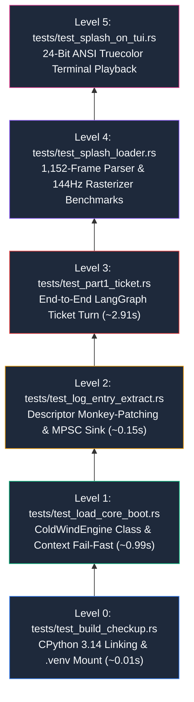

<div align="center">

<h1>🛠️ Contributing &amp; Verification Guide</h1>

<p>
  
  
  
</p>

<p>
  <em>Developer environment configuration, the 6-Target Cargo Integration Test Pyramid, and documentation verification gates for <strong>ai-workflow-gui</strong>.</em>
</p>

</div>

---

## ⚙️ 1. Development Environment & `.env.slint` Setup

`ai-workflow-gui` embeds CPython 3.14 at compile time and links directly against your `uv`-managed virtual environment.

### Required Environment Variables

1. **Compile-Time Venv Path (`COLDWIND_VENV`):**
   * `src/load_python.rs` reads `env!("COLDWIND_VENV")` to inject `site-packages` via `site.addsitedir()`.
   * Set it in `.cargo/config.toml` or export it before invoking Cargo:
     ```bash
     export COLDWIND_VENV="/path/to/ai-workflow-task-agent/.venv"
     ```
2. **Runtime Model Configuration (`.env.slint`):**
   * Located in the sibling workspace `../ai-workflow-task-agent/.env.slint`:
     ```env
     OPENAI_API_KEY=your_nvidia_nim_or_openai_api_key
     GPT_MODEL=meta/llama-3.3-70b-instruct
     ```

> [!TIP]
> **Fast Debug Compilation:** For rapid iteration without full release build times while keeping `fontdue` glyph rasterization fast, enable dependency optimizations in `Cargo.toml` (`[profile.dev.package."*"] opt-level = 3`) or run `cargo run --release`.

---

## 🧪 2. The 6-Target Integration Test Pyramid

All integration tests live in `tests/*.rs` and verify the boundary from CPython C-API linking up to `144 Hz` (`6.94 ms`) frame rendering:



### Running Individual Test Targets

```bash
# Level 0: Verify CPython 3.14 linking and coldwind.core import
cargo test --test test_build_checkup -- --nocapture

# Level 1: Verify ContextRegistry fail-fast invariant before boot
cargo test --test test_load_core_boot -- --nocapture

# Level 2: Verify C-API trampoline log interception into sync_channel(1024)
cargo test --test test_log_entry_extract -- --nocapture

# Level 3: Verify full headless TicketIn -> TicketOut turn execution
cargo test --test test_part1_ticket -- --nocapture

# Level 4: Benchmark 1,152-frame splash rasterizer across 720p, 1080p, and 1440p
cargo test --test test_splash_loader -- --nocapture

# Level 5: Preview Kyoto Dusk ASCII frames in 24-bit ANSI terminal truecolor
cargo test --test test_splash_on_tui -- --nocapture
```

### Why Cargo Runs Integration Tests as Separate Binaries

When you run `cargo test`, Cargo compiles tests in two distinct ways:
1. **Unit Tests (`src/`):** Compiled together into a single library/binary test executable.
2. **Integration Tests (`tests/*.rs`):** **Every `.rs` file directly inside `tests/` is compiled as its own independent executable binary crate** in `target/debug/deps/`.
   * Cargo runs each binary sequentially, printing `test result: ok. 1 passed` per binary rather than a single cumulative count.
   * This isolation ensures embedded CPython interpreter initialization (`Python::initialize()`) in one test never pollutes global `OnceLock` channels or `ContextRegistry` singletons in another test.

---

## 📚 3. Documentation & Refactoring Rules (`report-protocol`)

All architectural reports in `reports/` obey `.agents/skills/report-protocol/SKILL.md` and [`reports/foundations/00-authoring-and-sheet-law.md`](./reports/foundations/00-authoring-and-sheet-law.md):

1. **System-First Unnumbered Shelves:** Top-level folders in `reports/` must be unnumbered kebab-case (`system-architecture/`, `parity-audits/`, `foundations/`, `test-harness/`). Numeric prefixes (`01-`, `02-`) are allowed only on files inside a shelf.
2. **5-Section Shelf Indexes:** Every shelf `README.md` must include `## Domain`, `## Overview`, `## Interdependence Map`, `## Ownership Table`, and `## Index`.
3. **Zero Content Loss:** Never summarize or truncate existing deep-dive reports or cheat sheets. Run `python3 verify_refactor.py` before committing documentation changes.
4. **Strictly Relative Links:** Never commit `file:///` or local machine paths (`/home/...`).

---

## ✅ 4. Pull Request & Commit Checklist

- [ ] `cargo check --all-targets` compiles cleanly with zero warnings on modified modules.
- [ ] Relevant `cargo test --test <target>` integration binaries pass.
- [ ] All new Rust/Slint blocks include `// WHAT:`, `// WHY:`, and `// BRIDGE:` educational comments per [`AGENTS.md`](./AGENTS.md).
- [ ] Any architectural or gap status change is updated in [`CHANGELOG.md`](./CHANGELOG.md) and [`reports/`](./reports/README.md).