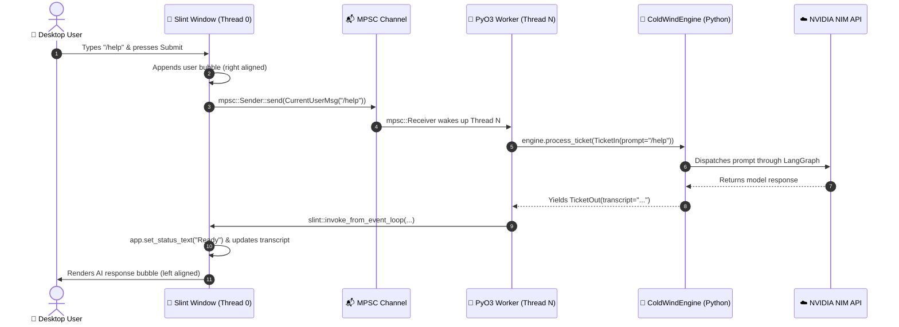

# ❄️ Cold Wind AI — Desktop GUI (Rust + Slint)

<div align="center">

```text
    ╔══════════════════════════════════════════════════════════════════╗
    ║             ❄️  COLD WIND AI DESKTOP GUI  ❄️                      ║
    ║      High-Performance Native Desktop Interface (Rust 2024)       ║
    ║      Slint UI 1.16 • Embedded PyO3 0.26 • LangGraph Engine       ║
    ╚══════════════════════════════════════════════════════════════════╝
```

[](https://www.rust-lang.org/)
[](https://slint.dev/)
[](https://pyo3.rs/)
[](https://www.python.org/)
[](https://opensource.org/licenses/MIT)
[](<>)

**High-performance, GPU-accelerated native desktop GUI built with Rust (2024 edition) and the Slint UI framework, embedding the headless Python 3.14 LangGraph AI engine via zero-overhead PyO3 FFI bindings and dual-thread non-blocking concurrency.**

</div>

---

## 🧭 Table of Contents

- [🧩 Quick Mental Model (1-minute)](#-quick-mental-model-1-minute)
- [🧠 PyO3 & Rust FFI Mental Models](#-pyo3--rust-ffi-mental-models)
  - [1. `Bound<'py, T>` vs `Py<T>` (Scoped Handle vs Heap Handle)](#1-boundpy-t-vs-pyt-scoped-handle-vs-heap-handle)
  - [2. GIL Attachment & Dual-Thread Topology](#2-gil-attachment--dual-thread-topology)
  - [3. `&self` Sinks vs `&mut self` Re-entrancy Panic](#3-self-sinks-vs-mut-self-re-entrancy-panic)
  - [4. `slint::Weak<AppWindow>` UI Marshalling](#4-slintweakappwindow-ui-marshalling)
- [📱 The Android Studio Mental Bridge (XML/Java ↔ Slint/Rust)](#-the-android-studio-mental-bridge-xmljava--slintrust)
- [🚀 What's New](#-whats-new)
- [✨ Current Status](#-current-status)
- [🌟 Core Capabilities & Architectural Pillars](#-core-capabilities--architectural-pillars)
- [⚡ Dual-Thread Runtime Topology](#-dual-thread-runtime-topology)
- [🗺️ Project Architecture](#️-project-architecture)
  - [🚀 Application Entry & Lifecycle](#-application-entry--lifecycle)
  - [🎨 Declarative UI Presentation Layer](#-declarative-ui-presentation-layer)
  - [🧬 Core Systems & FFI Type Contracts](#-core-systems--ffi-type-contracts)
  - [⚙️ Headless Engine Orchestrator](#️-headless-engine-orchestrator)
  - [📡 Native Logging Interception Sinks](#-native-logging-interception-sinks)
  - [🧪 Verification Test Suite](#-verification-test-suite)
  - [📚 Architecture & Learning Reports](#-architecture--learning-reports)
- [🧪 4-Tier Test Harness & Verification Suite](#-4-tier-test-harness--verification-suite)
  - [4-Tier Test Pyramid Overview](#4-tier-test-pyramid-overview)
  - [Individual Test Binaries & Invariants](#individual-test-binaries--invariants)
  - [Why Cargo Runs Integration Tests as Separate Binaries](#why-cargo-runs-integration-tests-as-separate-binaries)
- [🔄 End-to-End Data Flow](#-end-to-end-data-flow)
- [⚙️ Configuration & Environment (.env.slint)](#️-configuration--environment-envslint)
- [🚀 Quick Start](#-quick-start)
- [📚 Documentation Library](#-documentation-library)
- [🎯 Roadmap](#-roadmap)
- [📄 License](#-license)

---

## 🧩 Quick Mental Model (1-minute)

If you remember only _one_ diagram, remember this:

```text
┌────────────────────────────────────────────────────────────────────────┐
│  You type in Slint UI  →  MPSC Channel  →  PyO3 Engine  →  invoke_from │
│     (Thread 0: 60 FPS)    (Thread-Safe)   (Thread N)     (UI Redraw)   │
└────────────────────────────────────────────────────────────────────────┘
```

1. **User interacts with UI (Thread 0):** Slint renders smoothly at 60 FPS on the GPU. The window handle is `!Send` and NEVER touches Python code or acquires the GIL.
2. **Commands cross the bridge:** User messages are packed into lightweight Rust structs and sent over an asynchronous `std::sync::mpsc::channel` to Thread N.
3. **Headless Engine executes (Thread N):** An isolated OS thread hosts the CPython 3.14 runtime. It wakes up, executes LangGraph nodes, talks to LLMs via NVIDIA NIM, intercepts logs into native Rust queues, and generates a `TicketOut` transcript.
4. **State reflects back to UI:** Thread N schedules a closure onto Thread 0's event loop via `slint::invoke_from_event_loop()`, updating reactive Slint properties and triggering automatic GPU redraws.

---

## 🧠 PyO3 & Rust FFI Mental Models

Bridging native Rust memory with the CPython garbage-collected heap requires four foundational mental models:

### 1. `Bound<'py, T>` vs `Py<T>` (Scoped Handle vs Heap Handle)

In modern PyO3 0.26+ (PEP 703 compliant), memory ownership is strictly bifurcated:

```text
┌──────────────────────────────────┐        .unbind()       ┌──────────────────────────────────┐
│         Bound<'py, T>            │ ─────────────────────→ │              Py<T>               │
│  • Tied to stack lifetime 'py    │                        │  • Detached from 'py ('static)   │
│  • Borrowed from active GIL      │                        │  • Stored on heap inside structs │
│  • Cannot outlive closure block  │ ←───────────────────── │  • Can be moved across threads   │
└──────────────────────────────────┘         .bind(py)      └──────────────────────────────────┘
```

- **`Bound<'py, T>` (GIL-Bound Reference):** Represents a Python object verified to be valid while the GIL is currently held on this thread. You invoke methods directly on `Bound`.
- **`Py<T>` (Detached Python Handle):** Owns a Python reference pointer on the CPython heap with a `'static` lifetime. It can be stored inside Rust structs (such as `SlintRuntime`) or transferred across threads. To invoke methods on it, you re-attach it to an active GIL scope using `.bind(py)`.

### 2. GIL Attachment & Dual-Thread Topology

```text
Thread 0 (Slint UI Loop):
  ❌ NEVER call Python::attach(|py| ...)
  ❌ NEVER wait on Python locks
  ✅ Always free to process mouse, keyboard, and GPU repaint events

Thread N (Engine Worker Thread):
  ✅ Calls Python::attach(|py| { ... }) to enter CPython runtime
  ✅ Calls py.detach() when performing long network I/O to release the GIL
  ✅ Blocks at 0% CPU on mpsc::Receiver when idle
```

### 3. `&self` Sinks vs `&mut self` Re-entrancy Panic

```text
                      Python LangGraph Turn (Thread N)
                                    │
                                    ▼
                         emit structured log event
                                    │
                  ┌─────────────────┴─────────────────┐
                  ▼                                   ▼
        WRONG: &mut self sink               RIGHT: &self sink
        ┌─────────────────────────┐         ┌─────────────────────────┐
        │ RustGuiEventHandler     │         │ RustGuiEventHandler     │
        │ fn handle(&mut self)    │         │ fn handle(&self)        │
        └─────────────────────────┘         └─────────────────────────┘
                  │                                   │
                  ▼                                   ▼
        💥 PyBorrowMutError!                ✅ Non-blocking forward
        (Python already holds borrow;       (Thread-safe mpsc::Sender
         re-entrant call crashes VM)         clones & sends in 0.1ms)
```

### 4. `slint::Weak<AppWindow>` UI Marshalling

Slint window instances (`AppWindow`) are internally ref-counted (`Rc`) and are explicitly `!Send` (they cannot leave Thread 0). 

To update the UI from Thread N:
1. Thread 0 creates a weak, thread-safe reference: `let ui_weak = app.as_weak();` (`Send + Sync`).
2. Thread N captures `ui_weak` and submits a task back to Thread 0:
   ```rust
   slint::invoke_from_event_loop(move || {
       if let Some(ui) = ui_weak.upgrade() {
           ui.set_status_text("Engine Finished".into());
       }
   }).unwrap();
   ```

---

## 📱 The Android Studio Mental Bridge (XML/Java ↔ Slint/Rust)

For developers coming from Android Studio (XML layouts, Activities, and the imperative `findViewById` model):

| Android Studio (XML + Java/Kotlin) | Slint + Rust Equivalent | Architectural Contrast / What Changed |
|---|---|---|
| `res/layout/activity_main.xml` | [`ui/app-window.slint`](file:///home/pirate/development/ai-workflow-gui/ui/app-window.slint) | Both are declarative markup declaring visual elements, layout constraints, and padding. |
| `R.java` / `ViewBinding` generated class | `slint-build` generated struct in `OUT_DIR` | Both compile markup into typed host-language code at build time. |
| `MainActivity.java` / `onCreate()` | [`src/main.rs`](file:///home/pirate/development/ai-workflow-gui/src/main.rs) / `fn main()` | The entry point where the window is initialized and callbacks are attached. |
| `findViewById(R.id.my_view)` | **NO DIRECT EQUIVALENT** | ⚠️ **The Big Shift:** Slint does NOT expose individual child Views as mutable objects! |
| `textView.setText("Hello")` (Imperative) | `app.set_status_text("Hello".into())` (Reactive) | Instead of traversing a View tree and mutating it directly, you set a property on the root Component handle. |
| `button.setOnClickListener(v -> { ... })` | `app.on_send_message(\|msg\| { ... })` | Callbacks are declared on the component root and wired via closures on the generated Rust struct. |
| `LiveData<T>` / `android:text="@{vm.text}"` | Slint Property Binding `text: root.status-text;` | Slint uses two-way and one-way reactive property bindings directly inside `.slint`. |

---

## 🚀 What's New

### v0.0.1 – October 2026 (Phase 1 Baseline Complete)

| Milestone | Scope & Deliverables | Status |
|---|---|:---:|
| 🧊 **Headless Engine Boot** | Bootstrapped Python 3.14 `coldwind.slint_gui.main_orchestrator` directly from native Rust using PyO3 0.26. | ✅ Complete |
| 🛡️ **Fail-Fast Platform Context** | Verified engine refuses to execute without an active `PlatformRuntimeContext`, upholding fail-safe contracts. | ✅ Complete |
| 📡 **Descriptor Monkey-Patching** | Successfully intercepted Python logging descriptors (`RustGuiEventHandler`, `SlintGuiDisplay`) and routed logs into native Rust MPSC channels. | ✅ Complete |
| 🎫 **Discrete Ticket In/Out** | Submits discrete `TicketIn` turns, runs full LangGraph routing, and unpacks `TicketOutResult` transcripts with live NVIDIA NIM models. | ✅ Complete |
| 🧪 **4-Tier Test Harness** | Built an autonomous 4-tier integration test pyramid covering CPython linking, engine boots, log deserialization, and ticket execution. | ✅ Complete |
| 📚 **Report Protocol Compliance** | Authored 100% compliant technical documentation domains in [`reports/`](file:///home/pirate/development/ai-workflow-gui/reports/) with zero broken links. | ✅ Complete |

---

## ✨ Current Status

| Component | Status | Details |
|---|:---:|---|
| 🦀 **Rust Toolchain** | ✅ | Rust 2024 edition, Cargo single-crate architecture |
| 🎨 **Slint Desktop UI** | ✅ | Slint v1.16.0 with WhatsApp-style alternating bubbles and reactive status dock |
| 🐍 **CPython Engine FFI** | ✅ | PyO3 v0.26.0 embedding Python 3.14.7 (`ai-workflow-task-agent/.venv`) |
| 🧵 **Dual-Thread Concurrency** | ✅ | Thread 0 (Slint UI Loop) and Thread N (Engine Worker) cleanly decoupled |
| 📡 **Log Interception Sinks** | ✅ | Native `&self` PyO3 descriptors forwarding into `mpsc::channel` |
| 🧪 **Integration Test Suite** | ✅ | 4 autonomous test binaries in `tests/`, 100% passing |
| 📖 **Technical Reports** | ✅ | 6 structured documentation domains in `reports/` |

---

## 🌟 Core Capabilities & Architectural Pillars

```text
┌─────────────────────────────────────────────────────────────────────────┐
│                         CORE CAPABILITIES                               │
├─────────────────────────────────────────────────────────────────────────┤
│                                                                         │
│  🦀 SAFE SYSTEMS CORE     ─→  Zero unsafe Rust, RAII memory management   │
│  🎨 60 FPS GPU RENDERING  ─→  Slint FemtoVG/Qt hardware acceleration    │
│  ⚡ DUAL-THREAD TOPOLOGY   ─→  Zero GIL execution on UI Thread 0         │
│  🐍 HEADLESS AI ENGINE    ─→  Embedded Python 3.14 LangGraph turns       │
│  🎫 DISCRETE TICKET I/O   ─→  Typed TicketIn prompt → TicketOut reply    │
│  📡 DESCRIPTOR SINK       ─→  Monkey-patches Python handlers to Rust     │
│  🧩 ANDROID BRIDGE        ─→  Declarative properties vs imperative views │
│  🧪 4-TIER TEST PYRAMID   ─→  Autonomous verification at every layer     │
│                                                                         │
└─────────────────────────────────────────────────────────────────────────┘
```

---

## ⚡ Dual-Thread Runtime Topology

The interface between native Rust + Slint and the embedded Python agent engine is governed by strict thread isolation:

```text
┌─────────────────────────────────────────────────┐
│              THREAD 0: SLINT UI LOOP            │
│  • GPU 60 FPS Rendering (FemtoVG / Qt backend)  │
│  • Window events & User Typing                  │
│  • Owns AppWindow handle (!Send)                │
│  • STRICT INVARIANT: ZERO Python GIL execution  │
└───────────────────────┬─────────────────────────┘
                        │
                        │ std::sync::mpsc::channel
                        │ (WorkerState::CurrentUserMsg)
                        ▼
┌─────────────────────────────────────────────────┐
│            THREAD N: PYO3 WORKER THREAD         │
│  • Hosts CPython 3.14 Runtime                   │
│  • Blocks at 0% CPU on mpsc::Receiver           │
│  • Executes LangGraph turns (TicketIn payload)  │
│  • Intercepts logs via &self PyO3 descriptors   │
│  • Schedules UI updates via invoke_from_event   │
└─────────────────────────────────────────────────┘
```

---

## 🗺️ Project Architecture

```text
ai-workflow-gui/
├── 🚀 Application Entry & Lifecycle
│   └── src/main.rs                  ✅ Application entry point, Slint event loop, and PyO3 background worker thread
│
├── 🎨 Declarative UI Presentation Layer
│   ├── ui/app-window.slint          ✅ Responsive desktop window with WhatsApp-style bubble layout & status dock
│   └── ui/components/               ✅ Reusable UI components and visual layout primitives
│
├── 🧬 Core Systems & FFI Type Contracts
│   ├── src/lib.rs                   ✅ Core library root exposing LogEntry, MetaData, TicketOutResult, and SlintRuntime
│   ├── src/load_python.rs           ✅ CPython 3.14 virtualenv discoverer, site-packages locator, and sys.path injector
│   ├── src/slint_py_engine.rs       ✅ Headless engine facade orchestrating TicketIn turns against LangGraph
│   └── src/log_entry_handler.rs     ✅ Native PyO3 descriptor interception sinks forwarding logs into MPSC channels
│
├── 🧪 Verification Test Suite
│   ├── tests/test_build_checkup.rs      ✅ Level 0: CPython 3.14 FFI link & virtualenv import verification
│   ├── tests/test_load_core_boot.rs     ✅ Level 1: ColdWindEngine class extraction & fail-fast boot assertion
│   ├── tests/test_log_entry_extract.rs  ✅ Level 2: PyO3 event handler monkey-patching & typed LogEntry extraction
│   └── tests/test_part1_ticket.rs       ✅ Level 3: End-to-end discrete ticket turn execution with LangGraph & NIM LLMs
│
└── 📚 Architecture & Learning Reports
    ├── reports/README.md            ✅ Documentation domain hub and active status dashboard
    ├── reports/cross-platform-docs/ ✅ PyO3 0.26+ FFI mechanics, GIL detachment, and concurrency architecture
    ├── reports/slint_active/        ✅ WhatsApp bubble layouts, reactive properties, and Slint smart pointers
    └── reports/test_harness/        ✅ 4-tier integration test pyramid deep-dives and verification logs
```

---

## 🧪 4-Tier Test Harness & Verification Suite

### 4-Tier Test Pyramid Overview

```text
               ▲
              / \
             / L3 \     Level 3: End-to-End Ticket Execution (LangGraph + NIM API)
            /------\
           /  L2    \    Level 2: Native Logging Sink Interception & Deserialization
          /----------\
         /    L1      \   Level 1: Engine Class Loading & Fail-Fast Boot Assertion
        /--------------\
       /      L0        \  Level 0: CPython FFI Linkage & Virtualenv Injection
      /------------------\
```

### Individual Test Binaries & Invariants

Each test file in [`tests/`](file:///home/pirate/development/ai-workflow-gui/tests/) serves as an autonomous behavioral specification:

| Tier | Test Binary | Scope & One-Line Summary | Key Invariants Asserted |
|:---:|---|---|---|
| **Level 0** | [`tests/test_build_checkup.rs`](file:///home/pirate/development/ai-workflow-gui/tests/test_build_checkup.rs) | **CPython FFI Link & Virtualenv Check**: Verifies native Python 3.14 linking and loads `coldwind.core` from the injected virtualenv. | Asserts `Python::attach`, `COLDWIND_VENV` presence, and `sys.path` injection. |
| **Level 1** | [`tests/test_load_core_boot.rs`](file:///home/pirate/development/ai-workflow-gui/tests/test_load_core_boot.rs) | **Engine Handle Extraction & Fail-Fast Check**: Imports `ColdWindEngine` class handle and asserts intentional fail-fast exit when booted without platform context. | Confirms engine refuses to run without an active `PlatformRuntimeContext`. |
| **Level 2** | [`tests/test_log_entry_extract.rs`](file:///home/pirate/development/ai-workflow-gui/tests/test_log_entry_extract.rs) | **Native Logging Interception & Deserialization**: Replaces Python logging descriptors with native Rust sinks and verifies typed `LogEntry` deserialization. | Validates non-blocking MPSC queuing and recursive `MetaData` JSON decoding. |
| **Level 3** | [`tests/test_part1_ticket.rs`](file:///home/pirate/development/ai-workflow-gui/tests/test_part1_ticket.rs) | **End-to-End Headless Ticket Execution**: Boots full `SlintRuntime`, dispatches a discrete `/help` `TicketIn`, and asserts LLM response transcript unpacking. | Exercises full LangGraph routing, classifier nodes, and live NVIDIA NIM API calls. |

### Running the Test Suite

Execute all tests via Cargo:

```bash
cargo test
```

Execute a specific tier individually:

```bash
# Level 0
cargo test --test test_build_checkup

# Level 1
cargo test --test test_load_core_boot

# Level 2
cargo test --test test_log_entry_extract

# Level 3
cargo test --test test_part1_ticket
```

### Why Cargo Runs Integration Tests as Separate Binaries

When you run `cargo test`, Cargo discovers tests in two places:
1. **Unit tests in `src/`**: Compiled into a single test runner binary.
2. **Integration tests in `tests/`**: **Every `.rs` file directly inside `tests/` is compiled as a separate, independent executable binary crate** in `target/debug/deps/`.

Because each test file is an independent executable:
- Cargo executes them sequentially.
- Each binary reports its own result (`test result: ok. 1 passed`).
- Standard `cargo test` does not print a cumulative sum across binaries; the final line you see is the result of the *last* binary executed, followed by `rustdoc --test` (`0 passed`).

---

## 🔄 End-to-End Data Flow



---

## ⚙️ Configuration & Environment (.env.slint)

Configuration is loaded from the upstream `.env.slint` configuration file located in `/home/pirate/development/ai-workflow-task-agent/.env.slint`:

```env
# ═══════════════════════════════════════════════════════════════
#                        API KEYS
# ═══════════════════════════════════════════════════════════════
OPENAI_API_KEY=your_nvidia_or_openai_api_key

# ═══════════════════════════════════════════════════════════════
#                        MODELS
# ═══════════════════════════════════════════════════════════════
DEFAULT_MODEL=google/diffusiongemma-26b-a4b-it
GPT_MODEL=google/diffusiongemma-26b-a4b-it
API_DEFAULT_API_MODEL=google/diffusiongemma-26b-a4b-it

# ═══════════════════════════════════════════════════════════════
#                        LOGGING
# ═══════════════════════════════════════════════════════════════
LOG_LEVEL=INFO
LOG_DISPLAY_MODE=slint_gui
```

Compile-time PyO3 environment variables are configured in [`.cargo/config.toml`](file:///home/pirate/development/ai-workflow-gui/.cargo/config.toml):

```toml
[env]
PYO3_PYTHON = "/home/pirate/development/ai-workflow-task-agent/.venv/bin/python"
COLDWIND_VENV = "/home/pirate/development/ai-workflow-task-agent/.venv"
```

---

## 🚀 Quick Start

### Prerequisites

- **Rust**: 1.85+ (2024 edition support)
- **Python**: 3.14+ (installed via the `ai-workflow-task-agent` virtualenv)
- **Graphics Backend**: OpenGL / Vulkan / X11 / Wayland (for Slint desktop windowing)

### Build & Run

```bash
# 1. Clone & Enter Directory
cd /home/pirate/development/ai-workflow-gui

# 2. Compile Slint UI & Rust Engine Bridge
cargo build

# 3. Execute Autonomous Integration Test Suite
cargo test

# 4. Launch Native Desktop GUI Application
cargo run
```

---

## 📚 Documentation Library

All architectural studies and learning notes are maintained in [`reports/`](file:///home/pirate/development/ai-workflow-gui/reports/) adhering to the Report Protocol:

| Domain | Directory | Focus & Contents |
|:---:|---|---|
| **Domain 1** | [`reports/cross-platform-docs/`](file:///home/pirate/development/ai-workflow-gui/reports/cross-platform-docs/) | PyO3 0.26+ FFI mechanics, GIL lifecycles, and dual-thread concurrency rules |
| **Domain 2** | [`reports/slint_active/`](file:///home/pirate/development/ai-workflow-gui/reports/slint_active/) | Slint WhatsApp bubble styling, component hierarchies, and reactive property bindings |
| **Domain 6** | [`reports/test_harness/`](file:///home/pirate/development/ai-workflow-gui/reports/test_harness/) | 4-tier integration test pyramid deep-dives and verification logs |

---

## 🎯 Roadmap

### Phase 0.0.1 (Current Milestone — Baseline Complete)
- [x] Slint UI desktop layout with WhatsApp-style bubbles and status dock
- [x] PyO3 0.26 headless `ColdWindEngine` boot orchestration
- [x] Python logging descriptor monkey-patching into native Rust MPSC channels
- [x] End-to-end discrete ticket turn execution with live NVIDIA NIM models
- [x] 4-tier integration test harness with 100% pass rate

### Phase 0.0.2 (Next Milestone — Real-Time GUI Integration)
- [ ] Connect native MPSC log receiver directly to real-time Slint UI log streaming
- [ ] Wire multi-turn conversation memory into the Slint `ListView` model
- [ ] Implement cancellation and interrupt tokens for active LLM generation
- [ ] Add dark/light theme switching and syntax highlighting for code blocks in chat bubbles

---

## 📄 License

MIT License. Designed and developed by **Cold Wind AI**.
All rights reserved.
