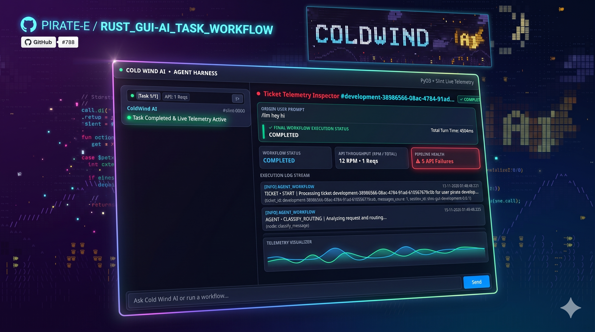
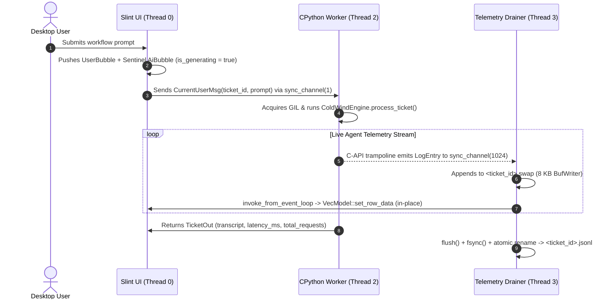

<div align="center">

```text
╔══════════════════════════════════════════════════════════════════════════════╗
║  ❄️  COLD WIND AI — NATIVE DESKTOP GUI (RUST 2024 + SLINT 1.16)              ║
║  Zero-Overhead Embedded CPython 3.14 • 3-Thread Actor Runtime • 144 Hz UI    ║
╚══════════════════════════════════════════════════════════════════════════════╝
```

<p align="center">
  <a href="https://www.rust-lang.org/"></a>
  <a href="https://slint.dev/"></a>
  <a href="https://pyo3.rs/"></a>
  <a href="https://www.python.org/"></a>
  <a href="./LICENCE.md"></a>
  <a href="./CHANGELOG.md"></a>
</p>

<h3>GPU-Accelerated Native Desktop Client for the Headless Cold Wind LangGraph Engine</h3>

<p>
  Built with <strong>Rust (2024 Edition)</strong> and <strong>Slint 1.16</strong>, embedding the headless <strong>CPython 3.14</strong> multi-agent engine directly in-process via <strong>PyO3 0.26 FFI</strong>—featuring a <strong>3-Thread Shared-Nothing Actor Runtime</strong>, a <strong>144 Hz ZSTD-Embedded ASCII Splash Engine</strong>, and <strong>ACID <code>.swap</code> &rarr; <code>.jsonl</code> Telemetry Persistence</strong>.
</p>

<p>
  <a href="#-quick-start"><strong>Quick Start</strong></a> &bull;
  <a href="#-architecture-at-a-glance"><strong>Architecture</strong></a> &bull;
  <a href="#-upcoming-goals"><strong>Upcoming Goals</strong></a> &bull;
  <a href="./CHANGELOG.md"><strong>Changelog & Roadmap</strong></a> &bull;
  <a href="./reports/README.md"><strong>Engineering Reports</strong></a>
</p>

<br />

<!-- Update the filename below if your screenshot inside assests/ or assets/ has a different name -->

<br />
<sub><em>Cold Wind AI Native Desktop Interface — 144 Hz Kyoto Dusk ZSTD Splash Screen &amp; Live Agent Telemetry Drawer</em></sub>

</div>

---

> [!IMPORTANT]
> **Production Architecture Parity:** `ai-workflow-gui` runs an in-process **3-Thread OS Actor Topology (`Threads 0, 2, 3`)** with zero IPC socket overhead, a **144 Hz (`6.94 ms` frame budget)** native UI loop, and crash-resilient **ACID `.swap` &rarr; `.jsonl`** disk persistence. Deep architectural blueprints live in [`reports/system-architecture/README.md`](./reports/system-architecture/README.md).

## 🧭 Navigation

| Section | Purpose | Companion Document |
| :--- | :--- | :--- |
| **[Architecture at a Glance](#-architecture-at-a-glance)** | 60-second mental model of the 3-thread runtime & data flow | [`reports/system-architecture/`](./reports/system-architecture/README.md) |
| **[Core Engineering Pillars](#-core-engineering-pillars)** | Splash engine, ACID persistence, PyO3 FFI, and Slint UI | [`reports/README.md`](./reports/README.md) |
| **[Upcoming Goals](#-upcoming-goals)** | High-level active milestones & Phase `0.0.2` targets | [`CHANGELOG.md`](./CHANGELOG.md) |
| **[Quick Start](#-quick-start)** | Environment setup (`.env.slint`) and Cargo build/run commands | [`CONTRIBUTING.md`](./CONTRIBUTING.md) |
| **[Governance & Rules](#-governance--project-files)** | Engineering commandments, test suite, and MIT license | [`CODE_OF_CONDUCT.md`](./CODE_OF_CONDUCT.md) |

---

## 🧩 Architecture at a Glance

Cold Wind AI decouples **presentation rendering**, **CPython agent inference**, and **telemetry persistence** across three isolated operating system threads:

```text
┌────────────────────────────────────────────────────────────────────────────────────────┐
│ THREAD 0: Slint UI Event Loop (!Send, 144 Hz / 6.94 ms Frame Budget)                   │
│  ├─ Booting ──► 144 Hz Timer ──► ZSTD .rodata Decompression ──► Fontdue Glyph Blit     │
│  ├─ Ready   ──► User Prompt  ──► sync_channel(1) ──► Thread 2 (CPython Worker)         │
│  └─ Inspect ──► Live RAM Buffer (is_generating) OR BufReader Cold Replay (.jsonl)      │
└───────────────────────────────────────────▲────────────────────────────────────────────┘
                                            │ slint::invoke_from_event_loop
             ┌──────────────────────────────┴──────────────────────────────┐
             │                                                             │
┌────────────┴───────────────────────────┐   ┌─────────────────────────────┴─────────────┐
│ THREAD 2: Embedded CPython 3.14 Worker │   │ THREAD 3: Telemetry & ACID Disk Drainer   │
│  ├─ Python::attach (Owns GIL)          │   │  ├─ Zero GIL Access (Pure Native Rust)    │
│  ├─ gc_connect (.venv site-packages)   │   │  ├─ Drains sync_channel(1024) LogEntries  │
│  ├─ C-API Descriptor Monkey-Patching   │   │  ├─ TicketUiState Autonomous FSM          │
│  └─ SlintRuntime::process_ticket()     │   │  └─ BufWriter (.swap) -> fsync -> .jsonl  │
└────────────────────────────────────────┘   └───────────────────────────────────────────┘
```

### End-to-End Turn Lifecycle



---

## 🌟 Core Engineering Pillars

<table>
  <tr>
    <td width="50%" valign="top">
      <h4>⚡ 1. 144 Hz ZSTD-Embedded ASCII Splash Engine</h4>
      <p>
        Compiles <strong>1,152 Kyoto Dusk frames</strong> (<code>160&times;64</code> RGB cells) compressed with <code>zstd -19</code> directly into the binary's <code>.rodata</code> segment via <code>include_bytes!</code>. Uses one-time <code>fontdue</code> glyph caching and gamma correction (<code>x<sup>0.7</sup></code>) to render at <strong>144 FPS (5.07 ms at 720p)</strong> with zero startup disk I/O.
      </p>
      <p><em>Source:</em> <code>src/splash_screen.rs</code> &bull; <a href="./reports/system-architecture/07-ascii-splash-screen-engine.md">Read Blueprint &rarr;</a></p>
    </td>
    <td width="50%" valign="top">
      <h4>🔒 2. ACID <code>.swap</code> &rarr; <code>.jsonl</code> Persistence</h4>
      <p>
        Inspired by Neovim swap files, <code>SwapLogFileWriter</code> streams domain <code>LogEntry</code> records into <code>&lt;ticket_id&gt;.swap</code> via an 8 KB <code>BufWriter&lt;File&gt;</code>, then commits turns atomically via <code>write(2)</code> + <code>fsync(2)</code> + <code>renameat2(2)</code>. Historical turns stream via <code>BufReader::lines()</code> without stalling the 144 Hz UI.
      </p>
      <p><em>Source:</em> <code>src/serialize_logs_in_file.rs</code> &bull; <a href="./reports/system-architecture/05-acid-swap-file-ingestion.md">Read Blueprint &rarr;</a></p>
    </td>
  </tr>
  <tr>
    <td width="50%" valign="top">
      <h4>🐍 3. Zero-Socket Embedded PyO3 0.26 FFI</h4>
      <p>
        Links CPython 3.14 in-process, mounts the <code>uv</code> virtual environment via <code>site.addsitedir()</code>, and monkey-patches Python logging classes with compiled Rust trampolines (<code>#[pyfunction]</code>) to extract typed <code>MetaData</code> trees with zero serialization overhead.
      </p>
      <p><em>Source:</em> <code>src/load_python.rs</code>, <code>src/log_entry_handler.rs</code> &bull; <a href="./reports/system-architecture/src/README.md">Read Blueprint &rarr;</a></p>
    </td>
    <td width="50%" valign="top">
      <h4>🎛️ 4. Reactive Slint UI &amp; 75% Telemetry Drawer</h4>
      <p>
        Features a Cyber-Slate <code>AiBubble</code> with live RPM/API velocity pills, in-place <code>VecModel::set_row_data</code> updates, and a 75%-width slide-over <code>TicketDrawer</code> with modal scrim backdrop and dual-mode inspection (live RAM buffer vs. cold disk replay).
      </p>
      <p><em>Source:</em> <code>ui/app-window.slint</code>, <code>ui/ticket-drawer.slint</code> &bull; <a href="./reports/system-architecture/ui/README.md">Read Blueprint &rarr;</a></p>
    </td>
  </tr>
</table>

---

## 🎯 Upcoming Goals

> [!TIP]
> **Active Engineering Focus (`Phase 0.0.2`):** Full sprint tracking, open audit issues (`GAP-02`–`GAP-06`), and multi-phase release milestones are maintained in [`CHANGELOG.md`](./CHANGELOG.md).

| Priority | Goal / Milestone | Target Subsystem | Status |
| :---: | :--- | :--- | :---: |
| **P0** | **Non-Blocking UI Turn Guard (`GAP-04`)** — Replace blocking `sync_channel(1)::send` with `try_send()` + `is_generating` UI lock | `src/main.rs`, `ui/app-window.slint` | `Active` |
| **P1** | **Native Slash Command Fast-Paths (`GAP-02`)** — Wire `/clear` session reset and `/exit` graceful shutdown | `src/slint_py_engine.rs`, `src/main.rs` | `Planned` |
| **P1** | **Rich Error Diagnostics Bubbles (`GAP-03` & `GAP-06`)** — Surface formatted Python `PyErr` tracebacks in red UI cards | `src/main.rs`, `src/log_entry_handler.rs` | `Planned` |
| **P2** | **Registered Tools Inspector Drawer (`GAP-05`)** — Bind `TOOL_INFO_LIST` metadata into a dedicated Slint drawer | `src/slint_py_engine.rs`, `ui/` | `Planned` |

---

## 🚀 Quick Start

### Prerequisites
* **Rust Toolchain:** Rust `1.85+` (`2024` Edition) with Cargo
* **Python Environment:** CPython `3.14+` and the upstream `coldwind-core` `uv` workspace
* **Environment Variable:** `COLDWIND_VENV` pointing to your `.venv` directory

### 1. Configure `.env.slint`
Create or verify `.env.slint` in your sibling `ai-workflow-task-agent/` workspace:

```env
OPENAI_API_KEY=your_nvidia_nim_or_openai_api_key
GPT_MODEL=meta/llama-3.3-70b-instruct
```

### 2. Build & Launch the Desktop GUI

```bash
# Export the virtual environment path required at compile time
export COLDWIND_VENV="$(pwd)/../ai-workflow-task-agent/.venv"

# Run in optimized release mode for locked 144 Hz splash & UI performance
cargo run --release
```

### 3. Run the 6-Target Verification Suite

```bash
# Run core FFI, boot, logging, and splash asset verification tests
cargo test --test test_build_checkup -- --nocapture
cargo test --test test_load_core_boot -- --nocapture
cargo test --test test_log_entry_extract -- --nocapture
cargo test --test test_splash_loader -- --nocapture
```

---

## 📚 Documentation Library

All deep-dive architectural reports, gap audits, benchmarks, and learning guides live in [`reports/`](./reports/README.md) under the **System-First Library Shelving Contract**:

| Shelf | Path | Contents |
| :--- | :--- | :--- |
| **System Architecture** | [`reports/system-architecture/`](./reports/system-architecture/README.md) | 3-thread actor runtime, ACID `.swap` persistence, 144 Hz ZSTD splash engine, and file-by-file `src/` & `ui/` guides |
| **Parity Audits** | [`reports/parity-audits/`](./reports/parity-audits/README.md) | Forensic CLI-vs-GUI gap audit (`GAP-01`–`GAP-07`) and interactive HTML inspector prototype |
| **Foundations** | [`reports/foundations/`](./reports/foundations/README.md) | First-principles PyO3 FFI guides, CPython `PyTypeObject` memory models, Slint tutorials, and Tier 1 cheat sheets |
| **Test Harness** | [`reports/test-harness/`](./reports/test-harness/README.md) | 6-target Cargo integration pyramid and 720p/1080p/1440p rasterizer benchmarks |

---

## 🛡️ Governance & Project Files

* **[`CHANGELOG.md`](./CHANGELOG.md)** — Version release history, active sprint tracker, and full multi-phase roadmap
* **[`CODE_OF_CONDUCT.md`](./CODE_OF_CONDUCT.md)** — Contributor conduct + mandatory PyO3 FFI & Android-to-Slint engineering commandments
* **[`CONTRIBUTING.md`](./CONTRIBUTING.md)** — Development setup, 6-target test pyramid guide, and documentation verification gates
* **[`LICENCE.md`](./LICENCE.md)** — MIT License