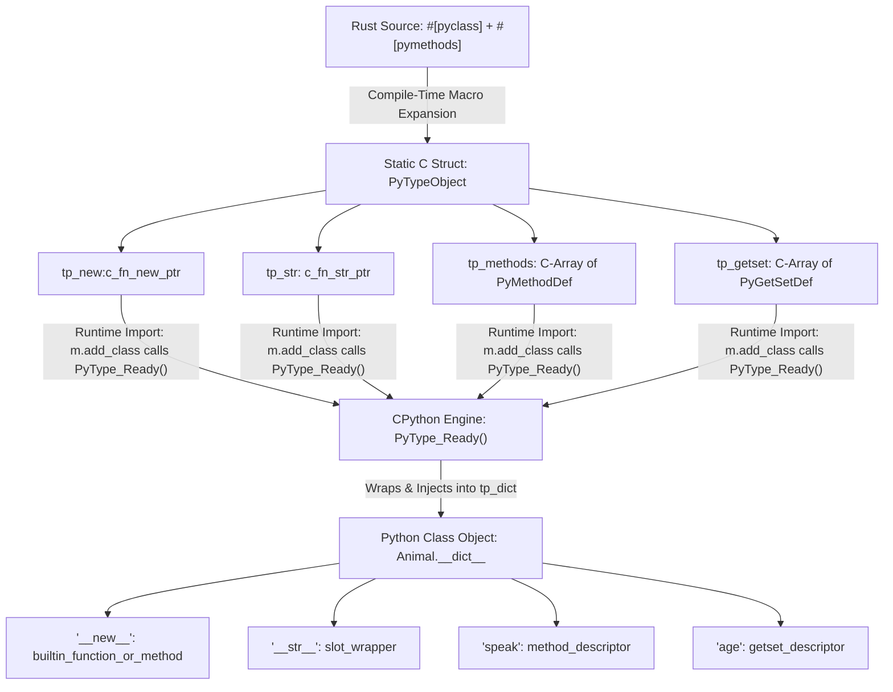
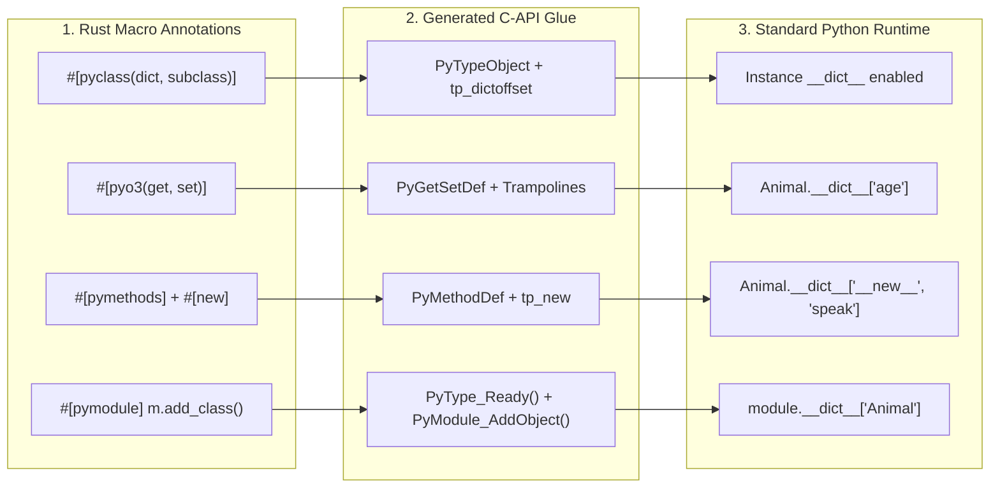

# Stage 3.1: `#[pyclass]`, `PyTypeObject`, and the CPython Descriptor Bridge

| Field | Value |
| :--- | :--- |
| **Domain** | PyO3 Internals & CPython C-API (Stage 3.1) |
| **Doc Type** | Concept Note & Architectural Investigation |
| **Verification Mode** | Codebase & CPython C-API Specification (VERIFIED) |
| **Confidence** | VERIFIED (CPython `Include/cpython/object.h` & PyO3 Macro Expansion) |
| **Updated** | 2026-10-27 |
| **Related Docs** | [02-binary-wall-trampolines-and-memory-model.md](./02-binary-wall-trampolines-and-memory-model.md), [Stage 3.1 Master Cheat Sheet](../../notes/pyo3_stage_3_1_master_cheatsheet.md) |

> **TL;DR:** Standard Python resolves all attributes and methods through dictionary lookups (`Module.__dict__` $\rightarrow$ `Class.__dict__` $\rightarrow$ `Instance.__dict__`). PyO3 does **not** bypass this model; instead, `#[pyclass]` and `#[pymethods]` populate static C-level staging arrays (`tp_methods`, `tp_getset`, `tp_new`) inside a `PyTypeObject` struct, which CPython's `PyType_Ready()` engine reads at module initialization to automatically populate `Class.__dict__` with C-level **Descriptor Objects**.

---

## 1. The Core Mental Model Clash: Standard Python `__dict__` vs PyO3 `tp_*` Slots

In pure Python, everything revolves around three dictionary namespaces:
1. **Module Object:** Holds a `__dict__` mapping class names to Class Objects (`module.__dict__['Animal'] = Animal`).
2. **Class Object (`type`):** Holds a `__dict__` mapping method and attribute names to function objects and descriptors (`Animal.__dict__['speak'] = <function>`).
3. **Instance Object:** Holds a `ob_type` pointer to its Class Object and (in pure Python without `__slots__`) an instance `__dict__` for per-object dynamic attributes.

When learning PyO3, a major conceptual trap occurs: documentation frequently mentions C-API slots like `tp_methods`, `tp_getset`, and `tp_new`, making it sound like PyO3 invents an alien lookup system since you never write `instance.tp_get("age")` in Python.

**Visual 1.1: How to read this table** — Compare what you write in standard Python with its exact PyO3 Rust equivalent and the resulting CPython `__dict__` mutation.

| Standard Python Step | Pure Python Syntax | PyO3 Rust Equivalent | What Happens in CPython's `__dict__` Model |
| :--- | :--- | :--- | :--- |
| **1. Define Class Blueprint** | `class Animal: pass` | `#[pyclass] struct Animal { ... }` | Generates a static C `PyTypeObject` blueprint; allocates `Animal.__dict__` when registered. |
| **2. Define Constructor** | `def __new__(cls, age): ...` | `#[pymethods] impl Animal { #[new] fn new(age: i32) -> Self }` | Stores C function pointer in `tp_new`; `PyType_Ready()` injects wrapper into `Animal.__dict__['__new__']`. |
| **3. Define Dunder Method** | `def __str__(self): ...` | `fn __str__(&self) -> String` | Stores C function pointer in `tp_str`; `PyType_Ready()` injects `<slot_wrapper '__str__'>` into `Animal.__dict__['__str__']`. |
| **4. Define Normal Method** | `def speak(self): ...` | `fn speak(&self) -> &'static str` | Appends entry to `tp_methods` array; `PyType_Ready()` injects `<method_descriptor>` into `Animal.__dict__['speak']`. |
| **5. Define Field Accessor** | `@property def age(self): ...` | `#[pyo3(get, set)] age: i32` | Appends entry to `tp_getset` array; `PyType_Ready()` injects `<getset_descriptor>` into `Animal.__dict__['age']`. |
| **6. Register in Module** | *(Implicit on file load)* | `m.add_class::<Animal>()?;` | Calls `PyType_Ready(&AnimalType)` and sets `module.__dict__['Animal'] = Animal`. |

---

## 2. The Missing "3rd Mechanism": `PyTypeObject` and `PyType_Ready()`

Why do `tp_methods` and `tp_getset` exist if Python only searches `Class.__dict__`? Because Rust compiles to a native binary (`.so` or `.pyd`), not a Python script. At compile time, Rust cannot construct a live Python `dict` object on the Python heap because the Python interpreter is not running yet.

Instead, CPython's C-API requires compiled extensions to fill out a static C struct called **`PyTypeObject`**. The fields of `PyTypeObject` are prefixed with `tp_` (Type Pointer / Type Slot).

**Visual 2.1: The `PyType_Ready()` Bridge (Compile-Time Staging $\rightarrow$ Runtime `__dict__`)**
*How to read this diagram: Follow the flow from top to bottom to see how compile-time Rust macros fill C arrays, and how `PyType_Ready()` converts them into standard Python `__dict__` entries at import time.*



### The Three Categories of `tp_*` Slots in `PyTypeObject`

When `m.add_class::<Animal>()` runs inside `#[pymodule]`, it invokes CPython's **`PyType_Ready()`**. This C function inspects the `PyTypeObject` struct and processes three distinct categories of `tp_*` slots:

```text
Title: Internal Anatomy of CPython's PyTypeObject C-Struct
========================================================================================
struct PyTypeObject {
    // CATEGORY 1: Memory Layout & Identity
    const char *tp_name;         // "coldwind_core.Animal"
    Py_ssize_t tp_basicsize;     // sizeof(PyObject Header [16B]) + sizeof(PyCell<Animal>)
    PyObject *tp_dict;           // ---> Points to Animal.__dict__ (Initially NULL!)

    // CATEGORY 2: Direct C-VTable Slots (Fast-Path Dunder Pointers)
    newfunc tp_new;              // Triggered by #[new] -> Also wrapped into __dict__['__new__']
    initproc tp_init;            // Used for __init__
    reprfunc tp_str;             // Triggered by fn __str__ -> Also wrapped into __dict__['__str__']
    ternaryfunc tp_call;         // Triggered by fn __call__ -> Also wrapped into __dict__['__call__']
    destructor tp_dealloc;       // Drops Rust struct & frees Python heap block when refcnt == 0

    // CATEGORY 3: Descriptor Staging Arrays (Input Tables for PyType_Ready)
    PyMethodDef *tp_methods;     // Array of { "speak", c_speak_trampoline, METH_NOARGS, doc }
    PyGetSetDef *tp_getset;      // Array of { "age", c_get_age_trampoline, c_set_age_trampoline }
};
========================================================================================
```

<details>
<summary><strong>Deep Dive: Why does CPython have both Category 2 (VTable Slots) and <code>__dict__</code>?</strong></summary>

When you execute `str(a)` or `a + b` in Python, CPython does not want to hash the string `"__str__"` or `"__add__"` and perform a dictionary lookup every single time in a tight loop.
1. For built-in operators and core dunders (`__new__`, `__str__`, `__repr__`, `__len__`, `__add__`, `__call__`), CPython reserves dedicated function-pointer fields (`tp_new`, `tp_str`, `tp_call`) directly inside `PyTypeObject`. Calling `str(a)` in C simply follows `a->ob_type->tp_str(a)` in $O(1)$ pointer time.
2. However, because Python code might also inspect `Animal.__dict__['__str__']` or call `a.__str__()` as a named method, `PyType_Ready()` **automatically wraps** every non-null `tp_*` dunder slot into a `<slot_wrapper>` descriptor and inserts it into `Animal.__dict__`!
3. Conversely, for normal user methods (`speak`) and field properties (`age`), there are no dedicated C-struct fields in `PyTypeObject`. Thus, they are placed in the null-terminated arrays `tp_methods` and `tp_getset`, which `PyType_Ready()` iterates over to populate `Animal.__dict__`.
</details>

---

## 3. Why `#[pyclass]` is Mandatory (Why Raw `PyCell` Alone Cannot Work)

A common question when inspecting PyO3's architecture is: *"If `PyCell<T>` (or `PyClassObject<T>`) is the actual memory container on the Python heap that bridges Rust and Python, why can't I just allocate a `PyCell` directly without wrapping my struct in `#[pyclass]`?"*

The answer lies in the separation between an **Instance Container** (`PyCell<T>`) and a **Type Blueprint** (`PyTypeObject`).

**Visual 3.1: `PyCell` Container vs `#[pyclass]` Type Blueprint**
*How to read this table: Compare what `PyCell` provides (instance-level memory and borrow-checking) against what `#[pyclass]` generates (class-level CPython type metadata).*

| Component | What It Is | What It Owns | Why It Cannot Exist Alone |
| :--- | :--- | :--- | :--- |
| **`PyCell<T>`** *(Internal Instance Container)* | A C-compatible memory layout (`#[repr(C)]`) placed on the Python heap per instance. | 1. `PyObject` Header (`ob_refcnt`, `ob_type`)<br>2. Borrow-checker flags (`is_borrowed`)<br>3. The Rust struct `T` | Every `PyObject` header **must** have a valid `ob_type: *mut PyTypeObject` pointer. Without `#[pyclass]`, there is no `PyTypeObject` for `ob_type` to point to! |
| **`#[pyclass]`** *(Compile-Time Macro)* | A Rust procedural macro that implements the `PyClass` and `PyTypeInfo` traits for `T`. | 1. Static `PyTypeObject` allocation<br>2. `tp_dealloc` drop glue for `T`<br>3. `tp_basicsize` calculation | Without `PyCell<T>`, `#[pyclass]` is just a class blueprint (`type`) with no instances. |

If you tried to hand Python a raw pointer to a Rust struct or a raw `PyCell` without `#[pyclass]`:
1. Python would read the first 8 bytes as `ob_refcnt` and the next 8 bytes as `ob_type`.
2. When Python dereferences `ob_type` to find the class dictionary (`tp_dict`), garbage collector hooks, or destructor (`tp_dealloc`), it would dereference invalid memory and immediately **Segmentation Fault (SIGSEGV)**.

---

## 4. Complete Macro Attribute Anatomy (`#[pyclass]`, `#[pymethods]`, `#[pymodule]`)

To write PyO3 code that seamlessly integrates with standard Python, you use three macros that cooperate to build the `PyTypeObject`, populate `Class.__dict__`, and inject the class into `Module.__dict__`.

**Visual 4.1: End-to-End Macro Expansion & Injection Pipeline**
*How to read this diagram: Trace how each Rust attribute macro maps to a specific CPython C-API structure and lands in the final Python runtime dictionary.*



### Comprehensive Attribute Reference Table

**Visual 4.2: How to read this table** — Use this reference to see what each PyO3 macro attribute does in Rust, which C-API slot it fills, and how standard Python sees it.

| Macro / Attribute | Where It Is Placed | What Boilerplate It Solves | CPython C-API Target | Standard Python Equivalent |
| :--- | :--- | :--- | :--- | :--- |
| `#[pyclass]` | Above `struct Animal` | Generates `PyTypeObject`, `tp_basicsize`, and `tp_dealloc` (Rust `Drop` glue). | `PyTypeObject` struct | `class Animal:` with `__slots__ = (...)` (no instance `__dict__` by default). |
| `#[pyclass(dict)]` | Above `struct Animal` | Reserves an extra pointer in every instance for a dynamic Python `dict`. | Sets `tp_dictoffset > 0` | Normal `class Animal:` where `a.random_attr = 1` works dynamically. |
| `#[pyo3(get)]` | Above struct field `age: i32` | Generates a C-ABI getter trampoline that reads `self.age` and converts it to `PyObject*`. | Entry in `tp_getset` (`PyGetSetDef`) | `@property def age(self): return self._age` inside `Animal.__dict__['age']`. |
| `#[pyo3(set)]` | Above struct field `age: i32` | Generates a C-ABI setter trampoline that converts `PyObject*` to `i32` and mutates `self.age`. | Entry in `tp_getset` (`PyGetSetDef`) | `@age.setter def age(self, val): ...` inside `Animal.__dict__['age']`. |
| `#[new]` | Inside `#[pymethods]` above `fn new(...)` | Generates C-ABI constructor wrapper that allocates `PyCell<Self>` on Python heap. | Sets `tp_new` slot | `def __new__(cls, *args): ...` inside `Animal.__dict__['__new__']`. |
| `fn __str__(&self)` | Inside `#[pymethods]` | Recognizes dunder name and wires it directly to CPython's type VTable slot. | Sets `tp_str` slot | `def __str__(self): ...` inside `Animal.__dict__['__str__']`. |
| `fn speak(&self)` | Inside `#[pymethods]` | Generates C-ABI method trampoline with `PyCell` borrow-checking. | Entry in `tp_methods` (`PyMethodDef`) | `def speak(self): ...` inside `Animal.__dict__['speak']`. |

<details>
<summary><strong> Side-by-Side Verification Code: Rust Source vs Python Runtime Inspection</strong></summary>

```rust
use pyo3::prelude::*;

#[pyclass]
pub struct Animal {
    #[pyo3(get, set)]
    pub age: i32,
}

#[pymethods]
impl Animal {
    #[new]
    pub fn new(age: i32) -> Self {
        Animal { age }
    }

    pub fn __str__(&self) -> String {
        format!("Animal(age={})", self.age)
    }

    pub fn speak(&self) -> &'static str {
        "Roar!"
    }
}

#[pymodule]
fn coldwind_core(m: &Bound<'_, PyModule>) -> PyResult<()> {
    m.add_class::<Animal>()?;
    Ok(())
}
```

When compiled and inspected in standard Python, the runtime structure matches the pure Python dictionary model 100%:

```python
import coldwind_core

# 1. Module __dict__ holds the Class Object
assert "Animal" in coldwind_core.__dict__

# 2. Class __dict__ holds all descriptors generated from tp_* tables by PyType_Ready()
print(list(coldwind_core.Animal.__dict__.keys()))
# ['__new__', '__str__', 'speak', 'age', '__doc__']

# 3. Inspecting descriptor types inside Animal.__dict__
print(type(coldwind_core.Animal.__dict__["speak"]))  # <class 'method_descriptor'>
print(type(coldwind_core.Animal.__dict__["age"]))    # <class 'getset_descriptor'>
print(type(coldwind_core.Animal.__dict__["__str__"])) # <class 'wrapper_descriptor'>
```
</details>

---

## Q&A Log

| # | Question | Answer (concrete) | Date |
| :--- | :--- | :--- | :--- |
| **Q1** | Why can't I just create a `PyCell` directly instead of wrapping my struct in `#[pyclass]`? | `PyCell` is only the instance memory container on the Python heap (`[PyObject Header \| Rust Struct]`). Every `PyObject` header requires an `ob_type` pointer to a valid `PyTypeObject` C-struct. `#[pyclass]` generates that static `PyTypeObject` metadata so CPython knows how to instantiate, call, and deallocate the `PyCell`. | 2026-10-27 |
| **Q2** | Does `#[pyclass]` create a `PyCell` automatically by itself? | No. `#[pyclass]` only generates the compile-time `PyTypeObject` blueprint and C-API bindings. A `PyCell` is allocated on the Python heap at runtime when you instantiate the class via `Animal()` in Python or `Py::new(py, Animal { ... })` in Rust. | 2026-10-27 |
| **Q3** | In standard Python, there is no `tp_methods` or `tp_getset`—only `__dict__`. Where do `tp_methods` and `tp_getset` live, and how do they connect to `__dict__`? | `tp_methods` and `tp_getset` are C-level arrays inside CPython's internal `PyTypeObject` struct. When the module loads and calls `PyType_Ready()`, CPython loops over `tp_methods` and `tp_getset`, wraps each Rust C-function pointer in a Python descriptor object (`method_descriptor` / `getset_descriptor`), and inserts them into `Class.__dict__`. | 2026-10-27 |
| **Q4** | If `#[new]` is used for object creation, do `__init__` and all other dunder methods also have separate implementations in PyO3? | Yes. Dunder methods like `__str__`, `__len__`, `__add__`, and `__call__` map to dedicated C function-pointer slots (`tp_str`, `sq_length`, `nb_add`, `tp_call`) inside `PyTypeObject` when defined inside `#[pymethods]`, which `PyType_Ready()` also exposes in `Class.__dict__`. | 2026-10-27 |