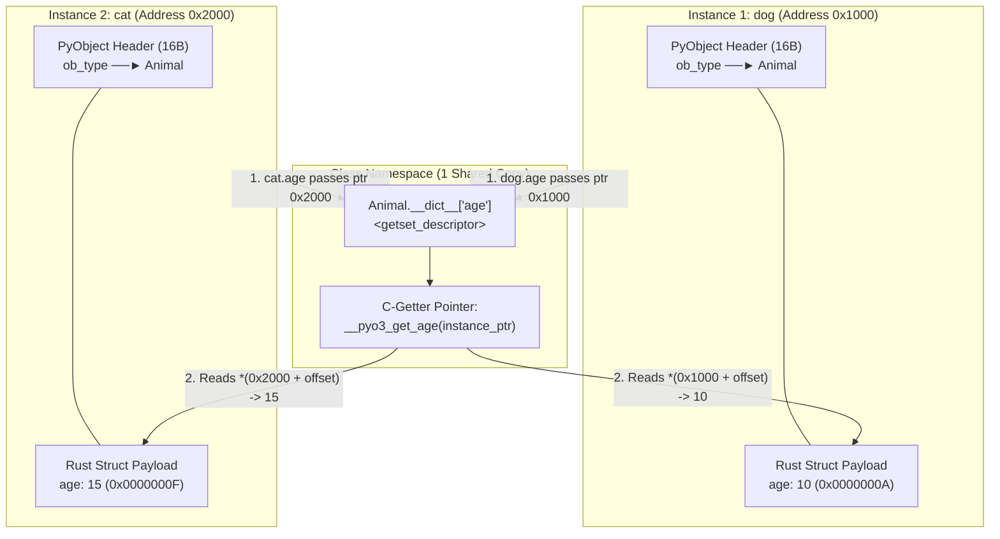
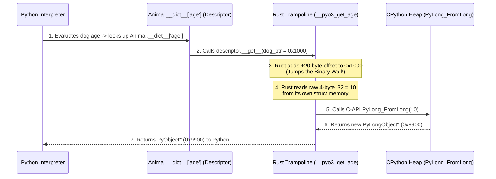

# Stage 3.1: The Binary Wall, C-ABI Trampolines, and PyO3's FFI Memory Model

| Field | Value |
| :--- | :--- |
| **Domain** | PyO3 Internals & CPython C-API (Stage 3.1) |
| **Doc Type** | Deep-Dive Investigation & Memory Architecture |
| **Verification Mode** | Codebase & CPython C-API Specification (VERIFIED) |
| **Confidence** | VERIFIED (CPython Descriptor Protocol & PyO3 `Py<T>` / `Bound<'py, T>` ABI) |
| **Updated** | 2026-10-27 |
| **Related Docs** | [01-pyclass-pytypeobject-and-descriptor-bridge.md](./01-pyclass-pytypeobject-and-descriptor-bridge.md), [Stage 3.1 Master Cheat Sheet](../../notes/pyo3_stage_3_1_master_cheatsheet.md) |

> **TL;DR:** Storing field descriptors (`age`) in `Class.__dict__` does **not** make the data a shared class attribute: the actual values (`10` vs `15`) live inside each instance's heap-allocated `PyCell<Animal>` struct, and `Class.__dict__['age']` holds a stateless descriptor that receives the specific instance pointer (`0x1000` vs `0x2000`). Furthermore, Python **never** reads Rust's binary memory directly; `#[pyo3(get)]` generates a hidden Rust C-ABI trampoline function that jumps the $+16\text{-byte}$ `PyObject` header wall, reads the raw Rust field, and converts it into a `PyObject*` for Python.

---

## 1. The Multi-Instance Paradox: How Class-Level Descriptors Read Instance-Level Memory

A critical doubt arises once you realize that `#[pyo3(get, set)]` places `'age'` inside **`Animal.__dict__['age']`** (on the Class) rather than inside an instance `__dict__`:
> *"If `'age'` is in `Animal.__dict__`, doesn't that make `age` a shared class attribute? How can two instances `dog` (`age = 10`) and `cat` (`age = 15`) exist simultaneously with different ages?"*

The resolution is CPython's **Descriptor Protocol** (the exact same mechanism used by pure Python's `__slots__`).
* **`Animal.__dict__['age']` does NOT store the number `10` or `15`.**
* It stores a stateless **`getset_descriptor` object** containing two C function pointers: `__get__(self, instance, owner)` and `__set__(self, instance, value)`.
* The actual numbers `10` and `15` are stored inside the separate heap memory blocks of `dog` (`0x1000`) and `cat` (`0x2000`).

**Visual 1.1: How One Class Descriptor Serves Multiple Instances (`dog` vs `cat`)**
*How to read this diagram: Notice how `Animal.__dict__['age']` is a single shared machine (descriptor) at the class level, while the data payloads (`10` and `15`) reside inside the separate instance memory blocks `0x1000` and `0x2000`.*



### Why PyO3 Uses Descriptors Instead of Instance `__dict__` (The `__slots__` Equivalence)

In pure Python, if you define `class Animal: __slots__ = ('age',)` without an instance `__dict__`, CPython does the exact same thing: it puts a `<member 'age'>` descriptor in `Animal.__dict__['age']` and stores the value at a fixed byte offset in the instance.

| Metric | Standard Python Instance `__dict__` | PyO3 `#[pyclass]` / Python `__slots__` |
| :--- | :--- | :--- |
| **Per-Instance Overhead** | Full HashMap allocation per instance ($\sim 112+$ bytes extra per object). | **Zero HashMap overhead.** Only the exact bytes of `struct Animal` ($4\text{ bytes}$ for `i32`). |
| **Attribute Lookup Cost** | Hash string `"age"` + probe instance hash table. | Resolve descriptor in `Class.__dict__` + direct C pointer offset read $O(1)$. |
| **Dynamic Attributes** | Allowed (`dog.random = 123` works). | Forbidden by default (unless `#[pyclass(dict)]` is explicitly added). |

---

## 2. Crossing the "Binary Wall": How Python Reads Rust Struct Memory

This brings us to the deepest FFI mystery:
> *"Python only understands `PyObject*` pointers and dictionaries. Inside `dog` (`0x1000`), after the 16-byte `PyObject` header, there is a raw 4-byte Rust binary integer (`0x0000000A`). Python has no idea what a Rust struct layout is! How on earth does Python cross that binary wall and read `age: 10`?"*

**The Ultimate Truth:** **Python NEVER reads Rust's binary memory.** Python is completely blind to anything past byte 16 of `dog` (`0x1000`).

When you write `#[pyo3(get)]`, the macro generates a hidden **Rust C-ABI Trampoline Function** (`__pyo3_get_age`). Python simply hands the `0x1000` pointer to this Rust function, and **Rust** jumps the wall, reads its own struct, converts the `i32` into a Python `int` (`PyLongObject`), and hands the `PyObject*` back to Python!

```text
Title: The 16-Byte Binary Wall Inside a PyCell<Animal> Instance (0x1000)
========================================================================================
Memory Address: 0x1000 (dog: *mut PyObject)
┌──────────────────────────────────────────────────────────────────────────────────────┐
│ [Bytes 00..08]  ob_refcnt : usize = 1               ◄── PYTHON SEES THIS             │
│ [Bytes 08..16]  ob_type   : *mut PyTypeObject       ◄── PYTHON SEES THIS (16 Bytes)  │
╞══════════════════════════════════════════════════════════════════════════════════════╡
│                         🧱 THE BINARY WALL (Byte 16) 🧱                              │
│          (Python is 100% blind below this line! Only Rust knows the layout)          │
╞══════════════════════════════════════════════════════════════════════════════════════╡
│ [Bytes 16..20]  borrow_flag : Cell<isize> = 0       ◄── PyCell Borrow Checker        │
│ [Bytes 20..24]  age         : i32 = 0x0000000A (10) ◄── Raw Rust Binary Struct       │
└──────────────────────────────────────────────────────────────────────────────────────┘
========================================================================================
```

**Visual 2.1: Step-by-Step Execution of `x = dog.age` Across the Binary Wall**
*How to read this sequence diagram: Follow the exact handoff from the Python interpreter to the C-level descriptor, into the Rust trampoline that reads the raw `i32` and calls `PyLong_FromLong`.*



<details>
<summary><strong>Inspect the Exact Rust Trampoline Code Generated by <code>#[pyo3(get, set)]</code></strong></summary>

When you write `#[pyo3(get)] pub age: i32`, the compiler expands it into an `unsafe extern "C"` function that matches CPython's `getter` function pointer signature (`typedef PyObject *(*getter)(PyObject *, void *)`):

```rust
// Conceptual expansion of #[pyo3(get)] for Animal::age
unsafe extern "C" fn __pyo3_get_age(
    slf: *mut pyo3::ffi::PyObject, // Python passes dog (0x1000) or cat (0x2000) here!
    _closure: *mut std::ffi::c_void,
) -> *mut pyo3::ffi::PyObject {
    // 1. Cast raw PyObject* (0x1000) to PyCell<Animal>* using known compile-time offset
    let cell_ptr = slf as *mut pyo3::PyCell<Animal>;

    // 2. Enforce Rust borrow-checking at runtime (ensures no active &mut self exists)
    let borrow_guard: pyo3::PyRef<'_, Animal> = (*cell_ptr).try_borrow().unwrap();

    // 3. RUST reads its own binary struct field (`i32` = 10)
    let raw_val: i32 = borrow_guard.age;

    // 4. Convert Rust `i32` into a new Python `int` (PyLongObject) on the Python heap
    //    via the IntoPy<PyObject> / ToPyObject trait (which calls PyLong_FromLong)
    pyo3::ffi::PyLong_FromLong(raw_val as std::os::raw::c_long)
}
```
</details>

---

## 3. The "Double Copy" Dilemma vs Zero-Copy Reference Passing (`Py<T>` & `Bound<'py, T>`)

Understanding the Binary Wall immediately explains **when** data is copied between Rust and Python and **when** it is zero-copy:

### Case A: Why Primitive Fields (`i32`, `f64`, `String`) Require Conversion on Read
Inside `dog` (`0x1000`), `age` is stored as a raw 4-byte Rust `i32` so that Rust methods (`fn birthday(&mut self) { self.age += 1; }`) can mutate it at native CPU speed without touching Python's C-API.
However, when Python code asks for `dog.age`, Python cannot hold a raw 4-byte `i32`—every variable in Python **must** be a `PyObject*` with a 16-byte header. Therefore, the getter trampoline calls `PyLong_FromLong(10)` to allocate a Python `int` object when read from Python.

### Case B: How Whole Structs Are Passed with ZERO Copying (`Py<T>` and `Bound<'py, T>`)
What if you have a large `#[pyclass] struct Matrix` and you want to pass an instance of `Matrix` from Rust into a Python function or method via `call_method1`?
* **The Trap:** If you clone the Rust struct or convert its fields into a Python list/dict every time, you get a catastrophic **Double Copy**.
* **The PyO3 Solution:** You allocate the struct **once** inside a `PyCell` on the Python heap using **`Py::new(py, instance)`**, which returns a **`Py<Matrix>`** handle (or **`Bound<'py, Matrix>`**).
* Passing `Py<Matrix>` or `&Bound<'py, Matrix>` to `call_method1` only passes the **8-byte memory address (`0x1000`)** and increments `ob_refcnt` by $1$! **Zero bytes of your Rust struct are copied.**

**Visual 3.1: Double-Copy Primitive Conversion vs Zero-Copy Handle Passing**
*How to read this table: Contrast what happens when passing a raw Rust primitive/collection versus passing a `#[pyclass]` handle (`Py<T>` / `Bound<'py, T>`) into `call_method1`.*

| Scenario | Rust Type Passed to `call_method1` | Trait Invoked (`IntoPy` / `ToPyObject`) | Memory Cost & Behavior |
| :--- | :--- | :--- | :--- |
| **1. Raw Primitive / Vec** | `i32`, `String`, `Vec<f64>` | Converts Rust memory into new `PyLong`, `PyUnicode`, or `PyList` on Python heap. | **$O(N)$ Copy:** Allocates a new Python object and copies the bytes across the FFI boundary. |
| **2. Owned `#[pyclass]` Struct** | `Animal { age: 10 }` (by value) | Allocates a new `PyCell<Animal>` on the Python heap and moves the struct into it. | **$O(1)$ Move to Heap:** Moves the struct once into the Python heap. |
| **3. Existing `#[pyclass]` Handle** | `&Py<Animal>` or `&Bound<'py, Animal>` | Increments `ob_refcnt` (`Py_INCREF`) on the existing `0x1000` heap pointer. | **TRUE ZERO-COPY ($O(1)$):** Both Rust and Python point to the exact same `0x1000` `PyCell` in RAM! |

---

## 4. Instantiation vs Invocation: `Py::new` / `#[new]` vs `call` / `call_method`

Another frequent point of confusion is why PyO3 separates `Py::new` / `#[new]` from `call` / `call_method`, and why you pass a `Py<T>` handle rather than a raw Rust struct reference `&T` to Python functions.

```text
Title: Lifecycle of a #[pyclass] Object — Creation vs Method Invocation
========================================================================================
PHASE 1: CREATION (Allocating the PyCell on the Python Heap -> Returns 0x1000)
  ├── From Python Code : `dog = Animal(10)`
  │     └── Invokes `Animal.tp_new` (generated by `#[new]`), allocates `0x1000`.
  └── From Rust Code   : `let dog: Py<Animal> = Py::new(py, Animal { age: 10 })?;`
        └── Directly allocates `PyCell<Animal>` at `0x1000` on Python heap and returns
            `Py<Animal>` (a safe Rust wrapper around the `0x1000` `PyObject*` pointer).

PHASE 2: PASSING TO PYTHON OR CALLING METHODS (Using the 0x1000 Handle)
  ├── Passing `dog` as an argument to a Python function:
  │     `py_func.call1(py, (&dog,))?;`
  │     └── Passes `0x1000` (`Py<Animal>`). Why not `&Animal`? Because Python needs the
  │         16-byte `PyObject` header at `0x1000`, NOT the raw Rust struct at `0x1014`!
  └── Calling a method on `dog` from Rust:
        `dog.bind(py).call_method0("speak")?;`
        └── Looks up `"speak"` in `Animal.__dict__` and invokes it with `0x1000`.
========================================================================================
```

### Why You Must Pass `Py<T>` (Handle) Instead of `&T` (Rust Reference) to Python

Look back at the Binary Wall diagram in Section 2:
* A Rust reference `&Animal` points directly to **Byte 20 (`0x1014`)**—the raw Rust struct payload. It does not point to a `PyObject` header, and it could even be sitting on the Rust stack rather than the Python heap!
* A **`Py<Animal>`** (or **`Bound<'py, Animal>`**) handle points to **Byte 0 (`0x1000`)** on the Python heap—the start of the 16-byte `PyObject` header (`ob_refcnt` + `ob_type`).
* Since every Python function expects a `PyObject*` starting at Byte 0 (`0x1000`), you must pass the `Py<Animal>` handle so Python sees a valid `PyObject` header and can manage its reference count safely.

---

## Q&A Log

| # | Question | Answer (concrete) | Date |
| :--- | :--- | :--- | :--- |
| **Q1** | If getters, setters, and methods are stored in `Class.__dict__`, doesn't that mean `age` is a class attribute and `dog` (`age=10`) and `cat` (`age=15`) cannot have different ages at the same time? | No. `Animal.__dict__['age']` does not store the integer `10` or `15`; it stores a stateless `getset_descriptor` object. The integers `10` and `15` live inside the separate heap allocations of `dog` (`0x1000`) and `cat` (`0x2000`). When you evaluate `dog.age`, Python calls `descriptor.__get__(0x1000)`, which reads `10` from `dog`'s memory; `cat.age` calls `descriptor.__get__(0x2000)`, which reads `15` from `cat`'s memory. | 2026-10-27 |
| **Q2** | Why did Rust/PyO3 choose `tp_getset` descriptors instead of putting attributes in an instance `__dict__`? Isn't that operationally convoluted? | It is actually CPython's fastest mechanism, identical to pure Python's `__slots__`. By using class-level descriptors + fixed struct offsets instead of a per-instance `__dict__` HashMap, 1 million `Animal` instances use $0$ HashMaps (saving gigabytes of RAM) and read fields via $O(1)$ pointer arithmetic. | 2026-10-27 |
| **Q3** | How can Python casually walk in and read raw binary Rust struct memory (`age: 10`) when Python only understands `PyObject*` and dicts? | **Python cannot and does not read Rust binary memory.** The `#[pyo3(get)]` macro generates a hidden **Rust C-ABI trampoline function** (`__pyo3_get_age`). Python passes `dog`'s pointer (`0x1000`) to this Rust function; **Rust** jumps the $+16\text{-byte}$ `PyObject` header wall, reads its own `i32` (`10`), calls CPython's `PyLong_FromLong(10)`, and returns the resulting `PyObject*` to Python. | 2026-10-27 |
| **Q4** | What trait must arguments implement to be passed into `call_method0` / `call_method1`, and what is its rule? | Arguments must implement `IntoPy<PyObject>` / `ToPyObject` (or `IntoPyObject` in newer PyO3). Its rule is to convert a Rust value into a valid `*mut PyObject` pointer on the Python heap—either by allocating a new Python object (for primitives) or by incrementing `ob_refcnt` on an existing `Py<T>` handle (zero-copy). | 2026-10-27 |
| **Q5** | Why do I have to pass a `Py<T>` handle into a Python function instead of passing the Rust struct instance or a raw Rust reference `&T`? | Because Python functions only accept `*mut PyObject` pointers that begin with a 16-byte `PyObject` header (`ob_refcnt` + `ob_type`) on the Python heap. A `Py<T>` handle points to the start of that `PyCell<T>` header (`0x1000`) on the Python heap, whereas a raw Rust `&T` points to raw struct bytes with no Python header. | 2026-10-27 |