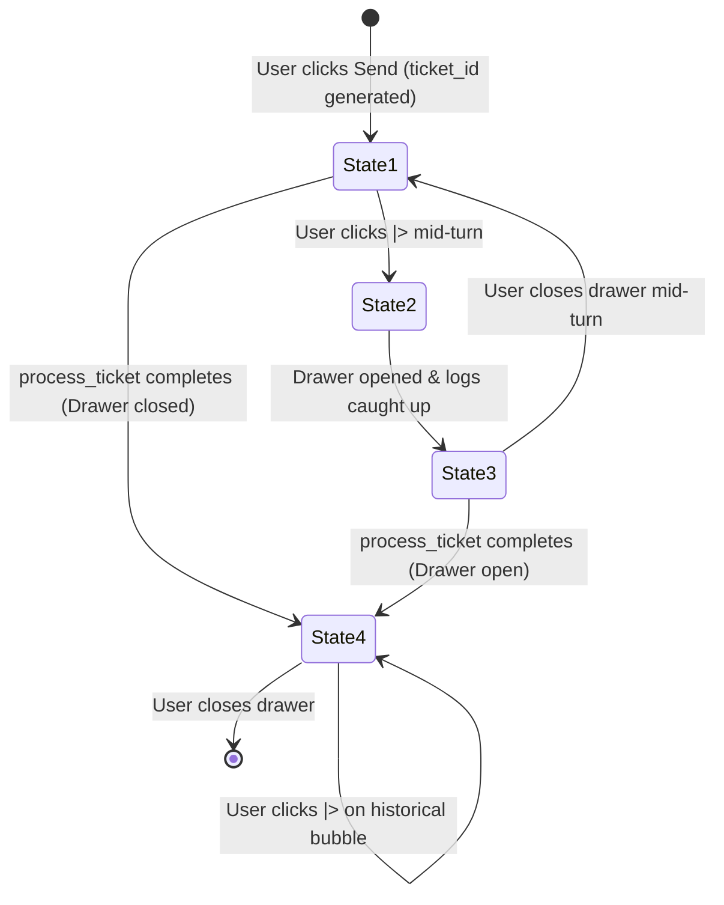
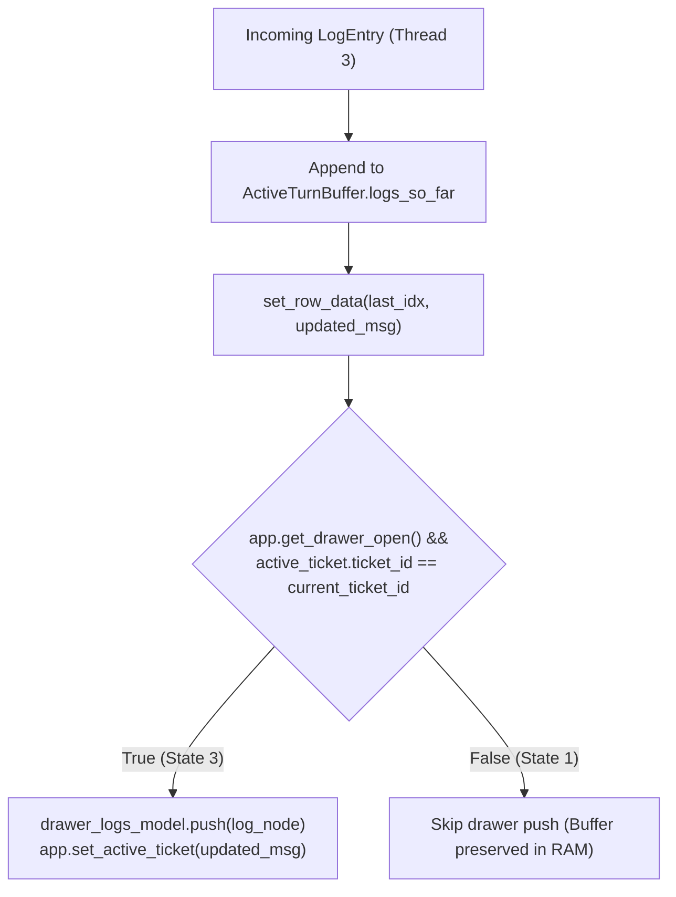
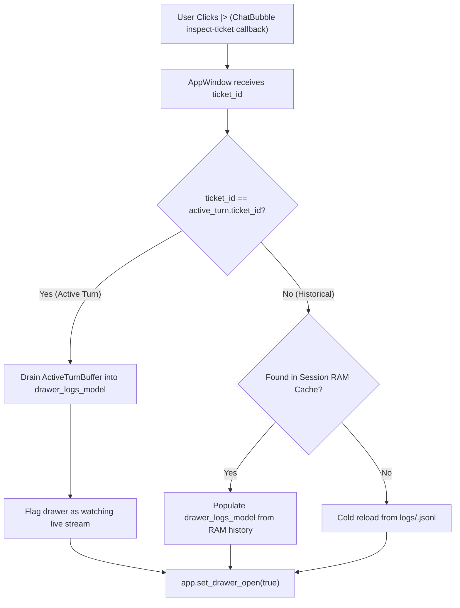
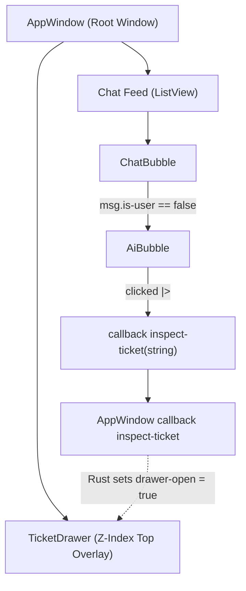

# Tier 1 (RAM): The 4-State Machine & Active Turn Buffer (Live In-Memory Stream)

| Attribute | Value |
| :--- | :--- |
| **Date** | 2026-11-01 |
| **Author / Role** | AI Systems Architect |
| **Domain** | `urgent_development / 01_slint_gui_telemetry_and_ux_parity` |
| **Storage Tier** | **TIER 1: RAM ONLY (Volatile In-Memory Active Stream)** |
| **Document Type** | Design / Decision |
| **Status** | 🟢 Approved |
| **Confidence** | VERIFIED |

> **TL;DR [RAM TIER]:** Governs volatile in-memory log routing while a ticket is actively executing. Thread 3 maintains a RAM-only `ActiveTurnBuffer` and `active_ticket_id` guard so live streaming logs animate the in-flight Sentinel bubble and the 75% slide-in drawer with **zero disk I/O, zero file locks, and zero torn reads**. For completed cold disk history, see [Report 04 (Disk Tier)](./04_disk_persistence_and_cold_reload.md).

---

## 1. Architectural Need & State Permutations

A message turn exists in one of four distinct states based on the cross-product of `is_generating` (ticket running vs completed) and `drawer_open` (drawer open vs closed). Without a deterministic state guard, opening the drawer during an active turn will either drop logs, show an empty sheet, or mix historical ticket data with background streaming logs.

| State ID | `is_generating` | `drawer_open` | Active Bubble Display | 75% Slide-In Drawer Behavior |
| :---: | :---: | :---: | :--- | :--- |
| **State 1** | `true` | `false` | **Silent In-Flight:** Amber border, pulsing dot, live summary text updates in place. | **Closed:** Drawer is hidden; incoming logs update the in-memory buffer only. |
| **State 2** | `true` | `false ──► true` | **Transition Click:** User clicks `\|>` mid-generation. Bubble stays amber. | **Open & Catch-Up:** Drawer opens, dumps accumulated RAM logs, and subscribes to live stream. |
| **State 3** | `true` | `true` | **Live Streaming:** Shimmer active; metrics continue live incrementation. | **Live Appending:** Every new `LogEntry` pushes a node card to the drawer in real time. |
| **State 4** | `false` | `true` | **Completed / Historical:** Static slate card, completion status, latency timestamp. | **Historical Freeze:** Drawer renders static log graph from RAM cache or disk; ignores background runs. |

*Lifecycle State Diagram: Transitions between in-flight generation, live inspection, and completion.*

---

## 2. Shared Active Turn Buffer Architecture

To guarantee that a user opening the drawer at second 5 of a 10-second turn sees the logs from seconds 0 to 4, Thread 3 maintains an in-memory `ActiveTurnBuffer`. 

| Component | Host Thread | Type & Storage | Responsibility |
| :--- | :--- | :--- | :--- |
| **`ActiveTurnBuffer`** | Thread 3 | `Arc<Mutex<ActiveTurnState>>` | Accumulates `LogEntry` records and telemetry counts for the currently running turn. |
| **`drawer_logs_model`**| Thread 0 | `Rc<VecModel<DrawerLogItem>>` | Slint model driving the drawer's `ListView`. Modified strictly via `invoke_from_event_loop`. |
| **`active_ticket_id`** | Shared | `AtomicString` / `String` | Unique key identifying the ticket currently displayed inside the drawer. |

*Conditional Log Dispatch: Thread 3 always updates the chat bubble row, but only routes logs into the drawer when watching the active ticket.*

---

## 3. The `inspect_ticket(id)` Decision Route

When the user clicks the expanding `|>` slide button on any bubble (whether live or historical), `AppWindow.inspect_ticket(ticket_id)` is invoked. The handler checks whether the clicked ID matches the active in-flight ticket or refers to a historical turn.

| Inspection Target | ID Comparison | Data Source | UI Action |
| :--- | :--- | :--- | :--- |
| **Live In-Flight Turn** | `clicked_id == current_active_id` | `ActiveTurnBuffer` (RAM) | Replaces drawer model with accumulated live logs; begins live streaming updates. |
| **Completed Turn (Current Session)** | `clicked_id != current_active_id` | Session History `HashMap` | Loads stored `Vec<DrawerLogItem>` from RAM session cache; sets drawer to read-only. |
| **Cold Historical Turn** | `clicked_id` not in RAM | Disk JSONL (`logs/<id>.jsonl`) | Reads and deserializes cold log nodes from disk file asynchronously. |

*Inspection Routing Logic: Determines data source based on ticket identity.*

---

## 4. UI Contract & Drawer Slint Component Wiring

To support this state machine without tight coupling, [`ui/app-window.slint`](../../ui/app-window.slint) hosts the slide-over drawer as an absolute overlay layer positioned at the bottom of the layout declaration.

| Property / Callback | Direction | Type | Purpose |
| :--- | :---: | :--- | :--- |
| `drawer-open` | `in-out` | `bool` | Controls slide-in translation (`x: root.drawer-open ? 25% : 100%`). |
| `active-ticket` | `in-out` | `ChatMessage` | Supplies KPI header metrics (progress, latency, status) to the drawer header. |
| `active-ticket-logs`| `in` | `[DrawerLogItem]` | Model driving the scrollable log node cards inside the drawer. |
| `close-drawer()` | `callback`| `()` | Emitted when clicking the drawer close icon or backdrop overlay. |
| `inspect-ticket(string)`| `callback`| `(string)` | Bubbled up from `ChatBubble` to trigger drawer opening in Rust. |

*Slint Callback Elevation: Event flows from leaf button up to AppWindow overlay.*

---

## 5. Traps & Edge-Case Safeguards

| Failure Mode | Root Cause | Engineering Safeguard |
| :--- | :--- | :--- |
| **Drawer Mid-Turn Emptiness** | Drawer opened mid-generation before logs were pushed to it. | Always copy `ActiveTurnBuffer.logs_so_far` into `drawer_logs_model` on open. |
| **Cross-Ticket Contamination** | Live logs push to drawer while user is reading an old ticket. | Guard drawer pushes with `active_ticket.ticket_id == current_ticket_id`. |
| **Z-Index Clipping** | Drawer declared above `ListView` in `.slint` file. | Place `TicketDrawer` at the very end of `AppWindow` to guarantee top Z-order. |

---

## 6. Q&A Log

| # | Question | Answer (concrete) | Date |
| :--- | :--- | :--- | :--- |
| **Q1** | Can the drawer be opened if no ticket is generating? | Yes. Clicking `\|>` on any past bubble loads its completed log graph into the drawer in read-only mode. | 2026-11-01 |
| **Q2** | What happens if the user closes the drawer while a turn is generating? | Generation continues uninterrupted; Thread 3 continues updating `ActiveTurnBuffer` and the chat bubble's summary pill. | 2026-11-01 |
| **Q3** | Does opening the drawer freeze the main chat scrolling? | No. The drawer occupies the right 75% of the window; the left 25% remains visible and responsive behind a semi-transparent scrim. | 2026-11-01 |
