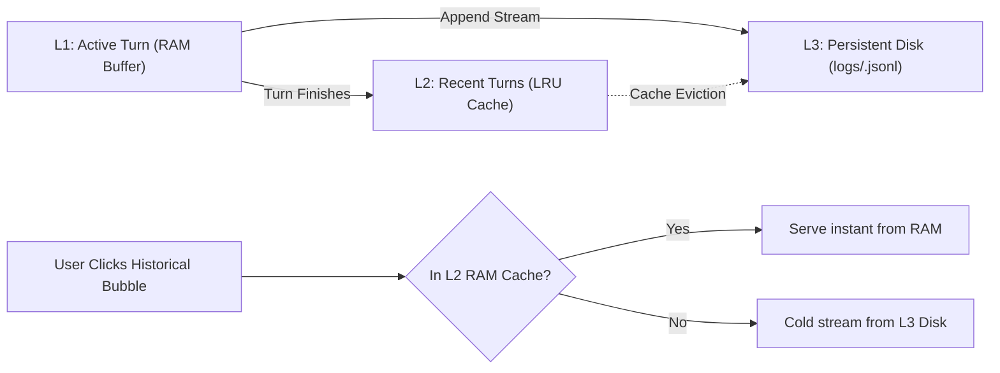
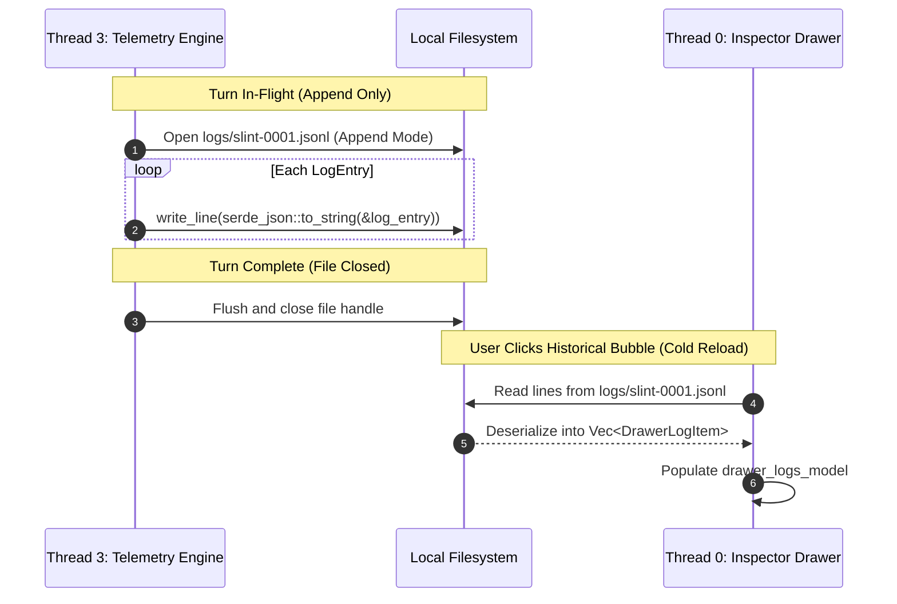
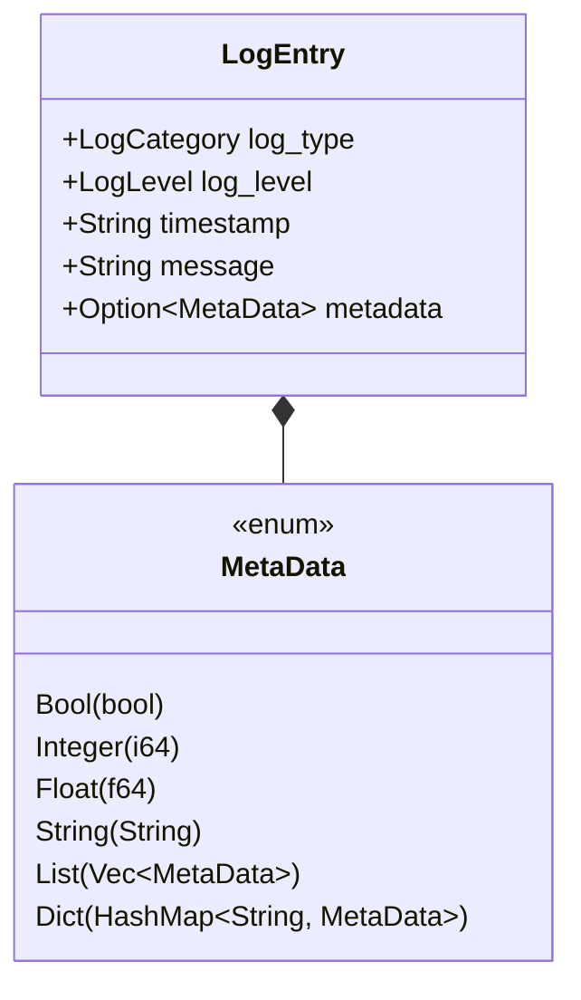
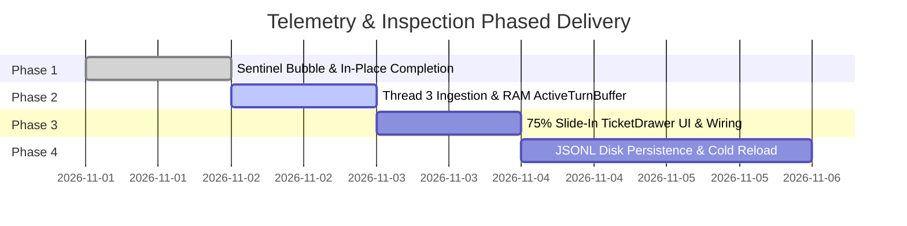

# Tier 2 (Disk): Telemetry Disk Persistence & Cold History Reload (On-Disk Archive)

| Attribute | Value |
| :--- | :--- |
| **Date** | 2026-11-01 |
| **Author / Role** | AI Systems Architect |
| **Domain** | `urgent_development / 01_slint_gui_telemetry_and_ux_parity` |
| **Storage Tier** | **TIER 2: DISK STORAGE (Append-Only JSONL Archive & Cold Replay)** |
| **Document Type** | Design / Decision |
| **Status** | 🟢 Approved |
| **Confidence** | VERIFIED |

> **TL;DR [DISK TIER]:** Governs permanent on-disk log persistence for completed tickets and past historical replay. Once a turn completes, finalized logs are flushed to append-only `logs/<ticket_id>.jsonl` files on disk, freeing volatile heap space and allowing hours-old conversations to be reloaded cold without keeping megabytes in RAM. For live in-flight turn buffering, see [Report 03 (RAM Tier)](./03_bubble_and_drawer_state_machine.md).

---

## 1. RAM vs. Disk Boundary Analysis

Desktop applications that retain unbounded log graphs in memory inevitably suffer from heap bloat and eventual OOM crashes during long pair-programming sessions. A clear boundary must separate the active in-flight turn from completed historical turns.

| Storage Tier | Data Lifecycle | Capacity Bound | Read / Write Performance |
| :--- | :--- | :--- | :--- |
| **L1: Active Turn RAM Buffer** | Live execution only (seconds 0 to N) | 1 Active Turn (~50–200 nodes) | Microsecond zero-copy memory access |
| **L2: Session Cache** | Current desktop session | 5 Most Recent Turns (LRU) | Sub-millisecond RAM retrieval |
| **L3: Persistent Disk Tier** | Permanent cold storage | Unbounded (`logs/<id>.jsonl`) | 2–5ms streaming disk read on demand |

*Three-Tier Storage Model: High-speed RAM for live turns, durable JSONL on disk for cold history.*

---

## 2. On-Disk JSONL Serialization Specification

Each interaction round generates a discrete log file at `logs/<ticket_id>.jsonl`. The JSONL (JSON Lines) format is chosen because it allows Thread 3 to append new entries line-by-line without re-serializing previous lines or corrupting the file if the application is suddenly killed.

| Field Name | Type | Description | Example |
| :--- | :--- | :--- | :--- |
| `timestamp` | `string` | Local ISO-style timestamp | `"01-11-2026 05:45:12.102"` |
| `log_level` | `string` | Canonical severity level | `"INFO"`, `"WARNING"`, `"ERROR"` |
| `log_type` | `string` | Classified category | `"API_CALL"`, `"TOOL_EXECUTION"`, `"AGENT_WORKFLOW"` |
| `message` | `string` | Human-readable log summary | `"Invoking node: chatBot"` |
| `metadata` | `object?` | Structured parameters & payload | `{"model": "gpt-4o", "latency_ms": 420}` |

*Append-Only Ingestion & Cold Reload: Fast linear appends during execution, clean file replay on inspection.*

---

## 3. Serialization Data Contract

To enable disk serialization, [`src/lib.rs`](../../src/lib.rs)'s `LogEntry`, `LogLevel`, `LogCategory`, and `MetaData` derive `serde::Serialize` and `serde::Deserialize`.

| Rust Type in `src/lib.rs` | Derived Traits | Serialization Strategy |
| :--- | :--- | :--- |
| `LogLevel` | `Serialize`, `Deserialize`, `Clone` | Serialized as uppercase string enum (`"INFO"`). |
| `LogCategory` | `Serialize`, `Deserialize`, `Clone` | Serialized as snake_case or SCREAMING_SNAKE string. |
| `MetaData` | `Serialize`, `Deserialize`, `Clone` | Recursive serde mapping matching JSON data types. |
| `LogEntry` | `Serialize`, `Deserialize`, `Clone` | Top-level struct containing timestamp, category, and payload. |

*Data Contract Hierarchy: `LogEntry` encapsulates typed metadata for lossless disk round-tripping.*

---

## 4. Implementation Phasing: Pragmatic vs. Premature

Balancing immediate stability against architectural over-engineering requires phased delivery. Full disk persistence is scheduled for Phase 3, keeping Phase 2 focused on the in-memory telemetry stream.

| Milestone Phase | Scope & Implementation | Complexity | Production Benefit |
| :---: | :--- | :---: | :--- |
| **Phase 1 (Completed)** | Sentinel bubble birth, in-place completion update via `set_row_data`. | Low | Basic reactive UI loop functional. |
| **Phase 2 (Immediate Priority)** | Dedicated Thread 3, RAM `ActiveTurnBuffer`, live bubble telemetry updates. | Medium | Eliminates 1024 deadlock; live 1s updates. |
| **Phase 3 (Follow-up)** | 75% `TicketDrawer` Slint UI component, live streaming drawer updates. | Medium | Visual workflow transparency for current turn. |
| **Phase 4 (Future Hardening)**| On-disk JSONL persistence, cold history reload on past tickets. | High | Permanent session recall; memory safety. |

*Delivery Timeline: Prioritizes live RAM telemetry before building disk persistence.*

---

## 5. Failure Modes & Edge-Case Protection

| Failure Scenario | Impact | Preventive Mechanism |
| :--- | :--- | :--- |
| **Corrupt JSONL Line** | Disk file contains partial line due to sudden crash. | Line-by-line parser ignores malformed lines with warning instead of aborting. |
| **Missing Log File** | User clicks `\|>` on a bubble whose log file was manually deleted. | UI displays fallback notice: `"Telemetry log unavailable for this ticket"`. |
| **Disk I/O Latency** | Synchronous disk writes stalling Thread 3 telemetry loop. | Use buffered writer (`BufWriter<File>`) with flushed boundaries at turn end. |

---

## 6. Q&A Log

| # | Question | Answer (concrete) | Date |
| :--- | :--- | :--- | :--- |
| **Q1** | Why use JSONL instead of SQLite for desktop logs? | JSONL requires zero C-dependencies, supports trivial append-only streaming, and can be inspected directly with `tail -f` or `jq`. | 2026-11-01 |
| **Q2** | Should we implement disk persistence before the drawer UI is done? | No. Phase 2 (RAM telemetry) and Phase 3 (Drawer UI) must be functional first. Disk persistence is an optimization for long sessions. | 2026-11-01 |
| **Q3** | Can disk reloads block the Slint UI thread? | No. Reading files from disk must execute on a background task or worker thread, then marshal parsed items via `invoke_from_event_loop`. | 2026-11-01 |
