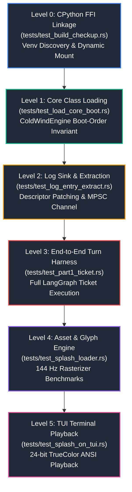

# Test Harness Shelf

## Domain
- **desktop** (`ai-workflow-gui` Rust test binaries) — Cargo integration tests and microbenchmarks.
- **shared** (`coldwind-core` PyO3 FFI boundary) — Python environment discovery, class loading, and ticket turn verification.

## Overview

> [!IMPORTANT]
> **Latest Codebase State:** The test harness consists of **6 autonomous integration test targets** in `tests/`, spanning bottom-up from PyO3 CPython 3.14 linking up to 144 Hz splash rasterization benchmarks and 24-bit ANSI truecolor terminal playback.

The `test-harness/` shelf documents the verification suite bridging the native Rust + Slint desktop GUI with the embedded Python 3.14 `coldwind-core` LangGraph engine. It defines the testing pyramid, environment validation, logging pipelines, and end-to-end ticket turn contracts.

### Which File Should I Open?

| If You Are Looking For... | Open This File |
| :--- | :--- |
| CPython environment checkup, FFI linkage, and virtualenv discovery (Tier 0) | [`./01_environment_and_runtime/01_cpython_environment_checkup.md`](./01_environment_and_runtime/01_cpython_environment_checkup.md) |
| Native MPSC log sinking, descriptor interception, and typed LogEntry extraction (Tier 2) | [`./01_environment_and_runtime/02_logging_sink_and_extraction.md`](./01_environment_and_runtime/02_logging_sink_and_extraction.md) |
| Headless ticket turn loop, LangGraph routing, and discrete ticket contracts (Tier 3) | [`./02_engine_ticket_pipeline/01_headless_ticket_turn_harness.md`](./02_engine_ticket_pipeline/01_headless_ticket_turn_harness.md) |
| 144 Hz Kyoto Dusk splash screen microbenchmarks, 1,152 frames, and 720p/1080p/1440p profiling | [`./02-splash-144hz-benchmarks.md`](./02-splash-144hz-benchmarks.md) |
| Environment & Runtime sub-domain overview | [`./01_environment_and_runtime/README.md`](./01_environment_and_runtime/README.md) |
| Engine Ticket Pipeline sub-domain overview | [`./02_engine_ticket_pipeline/README.md`](./02_engine_ticket_pipeline/README.md) |

---

### The Verification Pyramid

Testing an embedded PyO3 desktop application presents unique challenges: Rust must initialize CPython, mount external virtual environments, monkey-patch logging sinks, and drive asynchronous agent workflows while preserving strict memory and thread safety boundaries.

The test suite is structured as a hierarchical pyramid of integration targets:



### The 6 Test Levels at a Glance

| Level | Test Binary | Source File | Architectural Responsibility | Execution Time |
| :--- | :--- | :--- | :--- | :--- |
| **Level 0** | `test_build_checkup` | [`../../tests/test_build_checkup.rs`](../../tests/test_build_checkup.rs) | CPython 3.14 runtime linkage, virtual environment path resolution, and `coldwind.core` dynamic import. | ~0.01s |
| **Level 1** | `test_load_core_boot` | [`../../tests/test_load_core_boot.rs`](../../tests/test_load_core_boot.rs) | `ColdWindEngine` class handle extraction and validation of the ContextRegistry fail-fast invariant. | ~0.99s |
| **Level 2** | `test_log_entry_extract` | [`../../tests/test_log_entry_extract.rs`](../../tests/test_log_entry_extract.rs) | Native PyO3 descriptor injection into `RustGuiEventHandler` and strongly-typed `LogEntry` deserialization. | ~0.15s |
| **Level 3** | `test_part1_ticket` | [`../../tests/test_part1_ticket.rs`](../../tests/test_part1_ticket.rs) | Full headless lifecycle: orchestrator boot, `.env.slint` loading, `TicketIn` submission, and `TicketOutResult` validation. | ~2.91s |
| **Level 4** | `test_splash_loader` | [`../../tests/test_splash_loader.rs`](../../tests/test_splash_loader.rs) | 1,152-frame asset parsing, Fontdue glyph cache validation, and multi-resolution rasterizer benchmarks. | ~0.45s |
| **Level 5** | `test_splash_on_tui` | [`../../tests/test_splash_on_tui.rs`](../../tests/test_splash_on_tui.rs) | 24-bit ANSI truecolor terminal ASCII playback with BufWriter stdout locking and pacing. | ~8.00s |

---

### Test Runner & Cargo Invariants

Every test file in `tests/*.rs` is compiled by Cargo as a discrete integration test binary linked against both the crate root library (`ai_workflow_gui`) and the PyO3 CPython runtime.

| Cargo Command | Execution Behavior | Output & Diagnostics |
| :--- | :--- | :--- |
| `cargo test` | Runs the full integration suite sequentially across all 6 targets. | Displays test status counts for lib, bin, and each test target. |
| `cargo test --test test_build_checkup` | Executes only Level 0 smoke test. | Fastest smoke check for CPython linking and venv paths. |
| `cargo test --test test_log_entry_extract -- --nocapture` | Runs Level 2 log extraction with stdout unbuffered. | Prints deserialized `LogEntry` payload, log level, and metadata presence. |
| `cargo test --test test_part1_ticket -- --nocapture` | Runs Level 3 end-to-end turn with live stdout. | Displays full LangGraph turn transcript, latency, and status. |
| `cargo test --test test_splash_loader -- --nocapture` | Runs Level 4 splash benchmarks. | Prints resolution render times across 1440p, 1080p, and 720p. |
| `cargo test --test test_splash_on_tui -- --nocapture` | Runs Level 5 interactive terminal preview. | Emits full Kyoto Dusk ASCII animation in the console. |

---

### Key Takeaways & Best Practices

| Topic | Best Practice | Failure Consequence If Ignored |
| :--- | :--- | :--- |
| **Test Independence** | Each test file initializes its own Python attachment via `Python::attach(\|py\| ...)`. | Shared GIL state across concurrent tests can cause nondeterministic deadlocks. |
| **Logging Channel Isolation** | Tests requiring log extraction must invoke `init_sync_send_all()` before Python operations. | Late initialization causes Python debug calls to hit uninitialized channels or discard events. |
| **Fail-Fast Assertion** | Tests asserting error boundaries (e.g. `test_load_core_boot`) must assert `res.is_err()`. | Silent crashes or panic unwinding across the FFI boundary triggers undefined behavior. |
| **External Environment Pathing** | Paths to `.venv` are read at compile-time via `env!("COLDWIND_VENV")` set in `.cargo/config.toml`. | Hardcoded developer home paths cause test failures on foreign machines or CI/CD agents. |
| **Render Buffer Sizing** | Splash buffers must match target pixel dimensions ($W \times H \times 4$). | Buffer overflow or out-of-bounds slice access during blitting. |

---

## Interdependence Map

```text
┌────────────────────────────────────────────────────────────────────────┐
│                          TEST HARNESS TOPOLOGY                         │
│                                                                        │
│   tests/*.rs (6 Independent Cargo Integration Binaries)                │
│           │                                                            │
│           ├──► Tier 0..3: PyO3 FFI & LangGraph Ticket Verification     │
│           │    (01_environment_and_runtime/ & 02_engine_ticket_pipeline)│
│           │                                                            │
│           └──► Tier 4..5: Splash Engine Verification                   │
│                     │                                                  │
│                     ▼                                                  │
│   02-splash-144hz-benchmarks.md (1440p / 1080p / 720p Profiling)      │
│   (1,152 frames, Fontdue glyph cache, 6.94 ms frame budget)            │
└────────────────────────────────────────────────────────────────────────┘
```

## Ownership Table

| Domain | Folder | Source Files Governed | Documents |
| :--- | :--- | :--- | :--- |
| `desktop` / `shared` | `./` | `../../tests/test_build_checkup.rs`, `../../tests/test_load_core_boot.rs`, `../../tests/test_log_entry_extract.rs`, `../../tests/test_part1_ticket.rs`, `../../tests/test_splash_loader.rs`, `../../tests/test_splash_on_tui.rs` | [`./README.md`](./README.md) |
| `shared` | `./01_environment_and_runtime/` | `../../tests/test_build_checkup.rs`, `../../tests/test_load_core_boot.rs`, `../../tests/test_log_entry_extract.rs` | [`./01_environment_and_runtime/README.md`](./01_environment_and_runtime/README.md) |
| `shared` | `./02_engine_ticket_pipeline/` | `../../tests/test_part1_ticket.rs` | [`./02_engine_ticket_pipeline/README.md`](./02_engine_ticket_pipeline/README.md) |
| `desktop` | `./` | `../../src/splash_screen.rs`, `../../tests/test_splash_loader.rs`, `../../tests/test_splash_on_tui.rs` | [`./02-splash-144hz-benchmarks.md`](./02-splash-144hz-benchmarks.md) |

## Index
- [01_environment_and_runtime/ — CPython Environment & Logging Extraction](./01_environment_and_runtime/README.md)
- [02_engine_ticket_pipeline/ — Headless LangGraph Ticket Pipeline](./02_engine_ticket_pipeline/README.md)
- [02 — 144 Hz Kyoto Dusk ASCII Splash Benchmarks & Verification](./02-splash-144hz-benchmarks.md)
