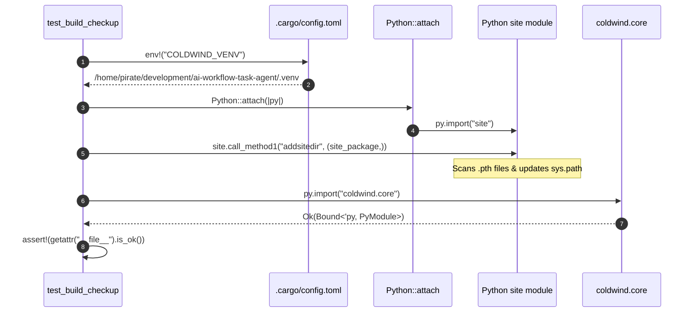
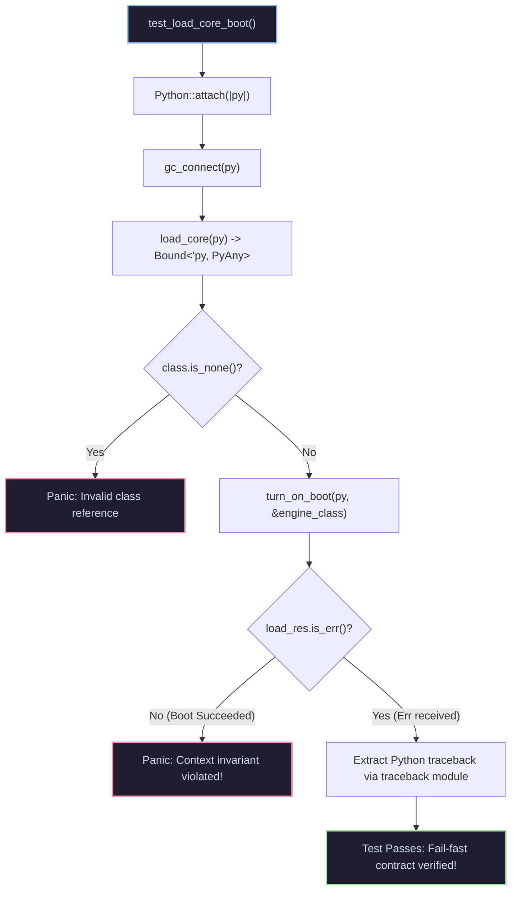

# 01 — CPython Environment Linkage & Engine Boot Checkup

| Field | Value |
| :--- | :--- |
| **Domain** | `test_harness` |
| **Subdomain** | `01_environment_and_runtime` |
| **Document** | `01_cpython_environment_checkup.md` |
| **Type** | Concept Note & Test Harness Deep Dive |
| **Tests Documented** | [`test_build_checkup.rs`](../../../tests/test_build_checkup.rs), [`test_load_core_boot.rs`](../../../tests/test_load_core_boot.rs) |
| **Verification Mode** | `Codebase Verified ✅` (PyO3 0.26+, CPython 3.14.7) |
| **Confidence** | `VERIFIED ✅` |
| **Updated** | `2026-10-31` |

> **TL;DR:** This report details the Level 0 and Level 1 test harnesses. `test_build_checkup.rs` verifies that Rust links against embedded CPython 3.14 and mounts the external `.venv` site-packages via `site.addsitedir()`. `test_load_core_boot.rs` verifies that `ColdWindEngine` loads correctly and enforces the fail-fast invariant when booted without an active `PlatformRuntimeContext`.

---

## 1. Test Anatomy & Specification

The Level 0 and Level 1 tests establish the physical FFI baseline for the entire application. Before any GUI window or agent graph is constructed, these tests guarantee that the native OS binary can communicate with the Python runtime and that the core engine respects runtime boundaries.

| Test Binary | Target Path | Test Level | Module Under Test | Primary Assertion |
| :--- | :--- | :--- | :--- | :--- |
| `test_build_checkup` | [`../../../tests/test_build_checkup.rs`](../../../tests/test_build_checkup.rs) | Level 0 (Smoke) | `.cargo/config.toml`, CPython C-API | `coldwind.core` module imports cleanly and exports `__path__` or `__file__`. |
| `test_load_core_boot` | [`../../../tests/test_load_core_boot.rs`](../../../tests/test_load_core_boot.rs) | Level 1 (Contract) | [`src/load_python.rs`](../../../src/load_python.rs), `ColdWindEngine` | `turn_on_boot()` fails fast with an `Err` when no platform context is registered. |

---

## 2. Level 0: The Dynamic Virtual Environment Linker (`test_build_checkup.rs`)

When embedding Python in Rust via PyO3, the embedded interpreter defaults to the system Python environment unless explicitly directed to a virtual environment. The application uses a compile-time environment injection pattern configured in `.cargo/config.toml`:

### Execution Step Analysis

| Step | Operation in `test_build_checkup.rs` | Rust / Python Mechanism | Purpose & Safety Guarantee |
| :--- | :--- | :--- | :--- |
| **1** | `let venv = env!("COLDWIND_VENV");` | Rust macro reading `.cargo/config.toml` | Guarantees compile-time failure if the target virtual environment path is missing. |
| **2** | `Python::attach(\|py\| { ... })` | PyO3 0.26+ thread attachment | Safely attaches the executing OS thread to the Python runtime, acquiring the GIL. |
| **3** | `site.call_method1("addsitedir", ...)` | CPython `site.py` dynamic mount | Processes `.pth` link files and appends `site-packages` to `sys.path`. |
| **4** | `py.import("coldwind.core")` | Dynamic module lookup | Validates that the headless package root is reachable across directory boundaries. |
| **5** | Attribute validation | `getattr("__file__").is_ok()` | Ensures the returned object is a genuine Python package, not a namespace stub. |

---

## 3. Level 1: Context Registry Fail-Fast Verification (`test_load_core_boot.rs`)

`ColdWindEngine` is designed as a headless facade. It cannot function without an active `PlatformRuntimeContext` (which provides logging sinks, exception dispatchers, and configuration). The Level 1 test enforces this architectural invariant: attempting to boot `ColdWindEngine` bare must fail fast and surface an explicit Python exception to Rust.

### Invariant & Assertion Matrix

| Check | Expected Behavior | Actual Behavior in Test | Verdict |
| :--- | :--- | :--- | :--- |
| **Class Handle Extraction** | `load_core(py)` returns valid `ColdWindEngine` class pointer. | `engine_class.is_none() == false` | `VERIFIED ✅` |
| **Context Absence Detection** | Upstream `ContextRegistry.get_active_context()` finds `None`. | Exception raised inside Python `ColdWindEngine.boot()` | `VERIFIED ✅` |
| **Rust Error Translation** | PyO3 converts Python exception into `PyResult::Err(PyErr)`. | `load_res.is_err() == true` | `VERIFIED ✅` |
| **Traceback Inspectability** | Python's `traceback.format_exception()` formats the error. | Rust extracts formatted traceback string cleanly without panicking. | `VERIFIED ✅` |

---

## 4. Verification & Diagnostic Commands

Run these targeted commands to execute Level 0 and Level 1 tests independently:

| Test Target | CLI Command | Expected Pass Time | Primary Diagnostic Output |
| :--- | :--- | :--- | :--- |
| **Level 0** | `cargo test --test test_build_checkup` | ~0.01s | `[test_build_checkup] Successfully imported: ...` |
| **Level 1** | `cargo test --test test_load_core_boot -- --nocapture` | ~0.99s | `[test_load_core_boot] ColdWindEngine raised expected exception: ...` |

---

## Q&A Log

| # | Question | Answer (concrete) | Date |
| :--- | :--- | :--- | :--- |
| **Q1** | Why does `test_build_checkup` use `site.addsitedir()` instead of simply pushing to `sys.path`? | `addsitedir()` processes `.pth` configuration files inside `site-packages`, ensuring editable installs and nested namespace packages resolve identically to normal virtualenv execution. | `2026-10-31` |
| **Q2** | Why do we write a test (`test_load_core_boot`) that intentionally asserts an error? | Because boot-order contracts must fail fast. If the engine booted silently without a platform context, it would corrupt state or fail deep inside an LLM turn with an incomprehensible null dereference. | `2026-10-31` |
| **Q3** | How does Rust inspect a Python traceback when an FFI call returns `Err(PyErr)`? | PyO3 stores the active exception; calling Python's `traceback.format_exception(load_err.get_type(py), load_err.value(py), load_err.traceback(py))` converts the raw exception object into a printable string list. | `2026-10-31` |
