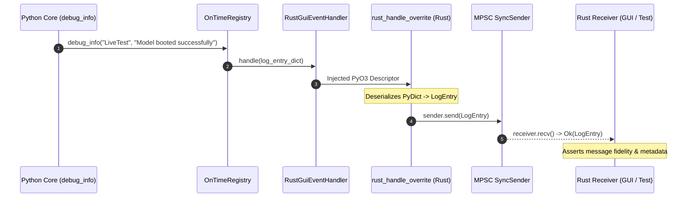
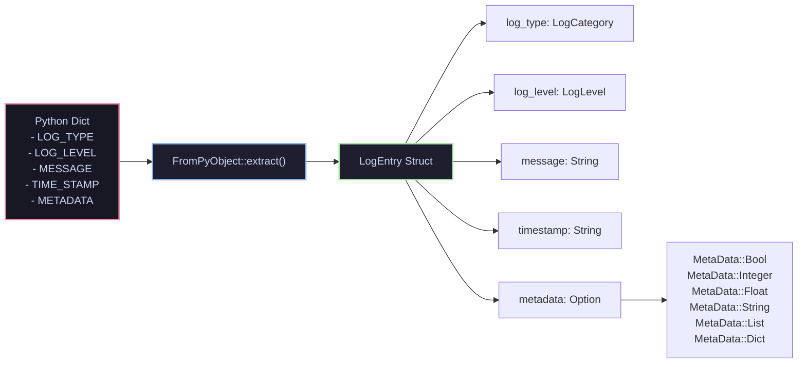

# 02 — Logging Sink Pipeline & Typed Deserialization

| Field | Value |
| :--- | :--- |
| **Domain** | `test_harness` |
| **Subdomain** | `01_environment_and_runtime` |
| **Document** | `02_logging_sink_and_extraction.md` |
| **Type** | Concept Note & Test Harness Deep Dive |
| **Tests Documented** | [`test_log_entry_extract.rs`](../../../tests/test_log_entry_extract.rs) |
| **Modules Under Test** | [`src/lib.rs`](../../../src/lib.rs), [`src/log_entry_handler.rs`](../../../src/log_entry_handler.rs) |
| **Verification Mode** | `Codebase Verified ✅` (PyO3 0.26+, CPython 3.14.7, Rust MPSC) |
| **Confidence** | `VERIFIED ✅` |
| **Updated** | `2026-10-31` |

> **TL;DR:** This report details the Level 2 integration test (`test_log_entry_extract.rs`). It validates the in-memory logging bridge: replacing Python's `RustGuiEventHandler.handle` descriptor with a native Rust pyfunction that deserializes incoming Python log events into typed `LogEntry` structs and forwards them across a thread-safe `mpsc::sync_channel`.

---

## 1. Test Anatomy & Architectural Invariant

Desktop applications must display real-time engine telemetry without polling disk files or managing local socket servers. The application achieves zero-overhead telemetry via native PyO3 descriptor monkey-patching.

| Component | Responsibility in `test_log_entry_extract.rs` | Implementation File | Verification Target |
| :--- | :--- | :--- | :--- |
| **MPSC Channel Init** | Creates the synchronized channel (`SyncSender<LogEntry>`) via `OnceLock`. | [`src/lib.rs`](../../../src/lib.rs) | Channel is non-blocking, initialized once, and returns a valid `Receiver`. |
| **Descriptor Hijack** | Overwrites `RustGuiEventHandler.handle` with native `rust_handle_overrite`. | [`src/log_entry_handler.rs`](../../../src/log_entry_handler.rs) | Injected descriptor intercepts Python calls to `handle(entry)`. |
| **Registry Binding** | Registers the patched handler with Core's `OnTimeRegistry`. | [`src/log_entry_handler.rs`](../../../src/log_entry_handler.rs) | `OnTimeRegistry` forwards every internal log event to the handler. |
| **Typed Deserialization** | Converts raw Python dictionary into Rust `LogEntry`. | [`src/lib.rs`](../../../src/lib.rs) | Correct parsing of `log_type`, `log_level`, `message`, and `metadata`. |

---

## 2. The In-Memory Log Pipeline & PyO3 Descriptor Hijacking

When upstream Python code calls `debug_info(origin, message)`, the event travels through an unbroken in-memory chain directly to Rust's channel receiver:

### Descriptor Patching Mechanics

| Stage | Python Original State | Patched Rust State | PyO3 Invocation |
| :--- | :--- | :--- | :--- |
| **Class Attribute** | `RustGuiEventHandler.handle` raises `NotImplementedError`. | Replaced with native pyfunction pointer. | `handler_class.setattr("handle", pyfunction)` |
| **Receiver Signature** | Accepts `(self, log_dict)`. | Rust function uses `&self` to guarantee re-entrant thread safety. | `#[pyfunction] fn rust_handle_overrite(...)` |
| **Registration** | Unregistered in `OnTimeRegistry`. | Bound as the active logging listener. | `registry.call_method1("register_handler", (handler,))` |

---

## 3. Native MPSC Channel & Zero-Copy Deserialization

The `FromPyObject` implementation for `LogEntry` parses raw Python dictionaries directly into Rust native types:

### Struct Field Mapping

| Rust Field | Expected Python Key | Extracted Rust Type | Fallback Policy on Missing Key |
| :--- | :--- | :--- | :--- |
| `log_type` | `LOG_TYPE.value` | `LogCategory` enum | Matches string; defaults to `LogCategory::OTHER`. |
| `log_level` | `LOG_LEVEL.value` | `LogLevel` enum | Matches string (`DEBUG`, `INFO`, `WARNING`, `ERROR`, `CRITICAL`). |
| `message` | `MESSAGE` | `String` | Strict requirement (extract fails if missing). |
| `timestamp` | `TIME_STAMP` | `String` | Generates local timestamp via `strftime_local` if missing. |
| `metadata` | `METADATA` | `Option<MetaData>` | Maps `None` to `Option::None`; extracts recursively otherwise. |

---

## 4. Test Execution & Assertion Analysis

In `test_log_entry_extract.rs`, the test verifies that:
1. `init_sync_send_all()` establishes the global channel.
2. `register_log_event_handler(py)` successfully hooks the descriptor.
3. Python `debug_info("LiveTest", "Model booted successfully")` emits the log.
4. `receiver.recv()` unpacks the native `LogEntry` with exact message fidelity: `"LiveTest | Model booted successfully"`.

| Assertion in Test | Source Code | Expected Outcome | Actual Result |
| :--- | :--- | :--- | :--- |
| **MPSC Receipt** | `receiver.recv().expect(...)` | Returns `Ok(LogEntry)` without timeout. | `VERIFIED ✅` |
| **Message Matching** | `assert_eq!(entry.message, ...)` | Exact string match with formatted Python log. | `VERIFIED ✅` |
| **Metadata Safety** | `entry.metadata.is_some()` | Evaluates safely without private method errors. | `VERIFIED ✅` |

---

## Q&A Log

| # | Question | Answer (concrete) | Date |
| :--- | :--- | :--- | :--- |
| **Q1** | Why must Rust callback structs exposed to Python use `&self` rather than `&mut self`? | PyO3 enforces runtime borrow checks (`PyCell`). If Python triggers a re-entrant log event while a mutable borrow is held, the runtime panics with `PyBorrowMutError`. Shared `&self` receivers prevent borrow conflicts. | `2026-10-31` |
| **Q2** | Why does `LogEntry` map metadata directly to `Option<MetaData>` instead of a custom null variant? | Idiomatic Rust uses `Option::None` for absent values, enabling standard combinators (`map`, `and_then`, `is_some`) without needing redundant `MetaData::Null` variants. | `2026-10-31` |
| **Q3** | Can multiple threads send log entries through the same `SyncSender` concurrently? | Yes. `SyncSender<LogEntry>` implements `Send + Sync + Clone`, allowing any number of worker threads or Python runtime hooks to emit logs safely into the single receiver. | `2026-10-31` |
