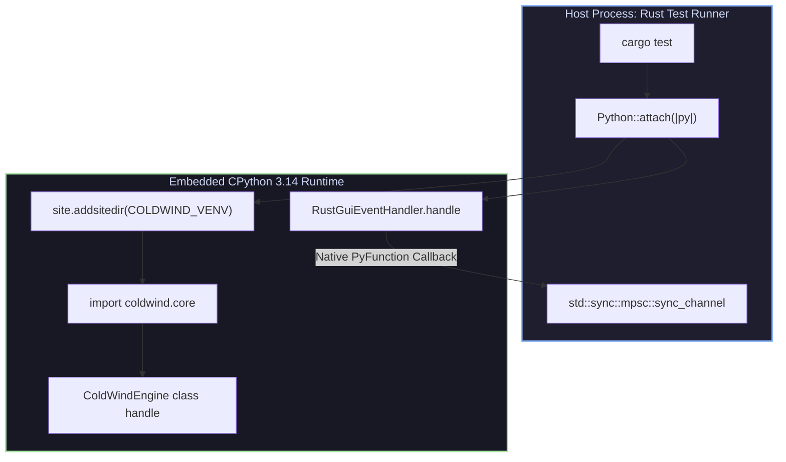

# ⚙️ Subdomain 01: Environment, Runtime & Log Sinks

| Field | Value |
| :--- | :--- |
| **Domain** | `test_harness` |
| **Subdomain** | `01_environment_and_runtime` |
| **Path** | [`reports/test_harness/01_environment_and_runtime/`](./README.md) |
| **Type** | Subdomain Index & Architectural Overview |
| **Verification Mode** | `Codebase Verified ✅` (PyO3 0.26+, CPython 3.14.7, Rust MPSC) |
| **Confidence** | `VERIFIED ✅` |
| **Total Test Targets** | 3 Integration Tests |
| **Updated** | `2026-10-31` |

> **TL;DR:** Subdomain 01 validates the lowest layers of the desktop FFI stack: embedding CPython 3.14, dynamically mounting the upstream `.venv` `site-packages`, enforcing the ContextRegistry boot-order invariant, and monkey-patching in-memory logging sinks to stream structured Python telemetry into native Rust MPSC channels.

---

## 📺 Recommended Learning & Reference Sources

| # | Source & Link | Architectural Focus | Verification |
| :--- | :--- | :--- | :--- |
| **1** | [`../../tests/test_build_checkup.rs`](../../../tests/test_build_checkup.rs) | Level 0 integration test validating CPython linking, venv mounting, and `coldwind.core` import. | `VERIFIED ✅` |
| **2** | [`../../tests/test_load_core_boot.rs`](../../../tests/test_load_core_boot.rs) | Level 1 integration test validating `ColdWindEngine` class loading and context fail-fast boundary. | `VERIFIED ✅` |
| **3** | [`../../tests/test_log_entry_extract.rs`](../../../tests/test_log_entry_extract.rs) | Level 2 integration test validating PyO3 descriptor injection and typed `LogEntry` deserialization. | `VERIFIED ✅` |
| **4** | [`../../cross-platform-docs/01_pyo3_core_mechanics/01-gil-and-interpreter-boot.md`](../../cross-platform-docs/01_pyo3_core_mechanics/01-gil-and-interpreter-boot.md) | Architectural foundations of PyO3 interpreter boot and GIL lifetime mechanics. | `VERIFIED ✅` |

---

## At a Glance & Navigation

| Document | Relative Path | Focus & Tests Documented | Status |
| :--- | :--- | :--- | :--- |
| **01 — CPython Environment Checkup** | [`./01_cpython_environment_checkup.md`](./01_cpython_environment_checkup.md) | Detailed breakdown of `test_build_checkup.rs` (Level 0) and `test_load_core_boot.rs` (Level 1). | `🟢 Complete` |
| **02 — Logging Sink & Extraction** | [`./02_logging_sink_and_extraction.md`](./02_logging_sink_and_extraction.md) | Detailed breakdown of `test_log_entry_extract.rs` (Level 2), descriptor patching, and MPSC deserialization. | `🟢 Complete` |
| **Parent Domain Index** | [`../README.md`](../README.md) | Root test harness domain index and test pyramid overview. | `🟢 Complete` |

---

## Architectural Topology

The following diagram illustrates how the Level 0, Level 1, and Level 2 tests isolate and verify each segment of the runtime boundary:

---

## Key Takeaways

| Pillar | Invariant Verified | Key Rust/Python Mechanism |
| :--- | :--- | :--- |
| **Virtualenv Mounting** | External packages in `/home/pirate/development/ai-workflow-task-agent/.venv` are accessible without system installation. | `site.addsitedir(site_package)` called within `gc_connect(py)`. |
| **Boot-Order Discipline** | `ColdWindEngine` cannot be booted in an unconfigured state. | ContextRegistry check fails fast, raising an exception caught and asserted by Rust. |
| **Descriptor Hijacking** | Python log events route directly into Rust memory with zero file/socket I/O. | `attach_handle_into_handler(py)` replaces Python class attribute with native `rust_handle_overrite`. |
| **Typed Deserialization** | Complex Python log dictionaries convert safely into strongly typed Rust enums. | `FromPyObject` implementation for `LogEntry`, `LogLevel`, `LogCategory`, and `MetaData`. |
