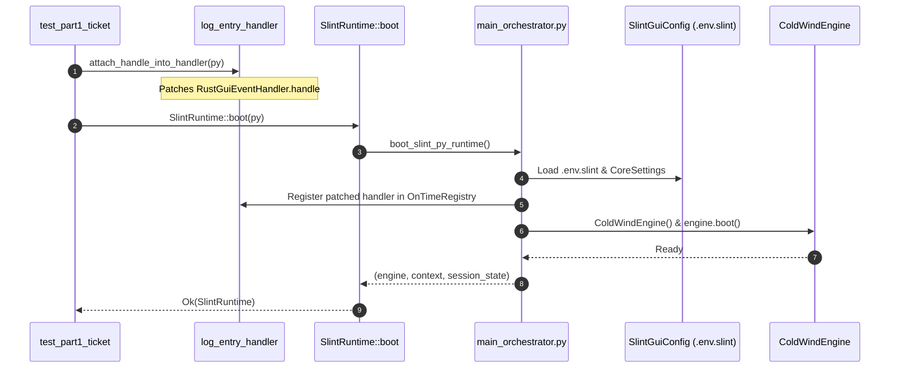
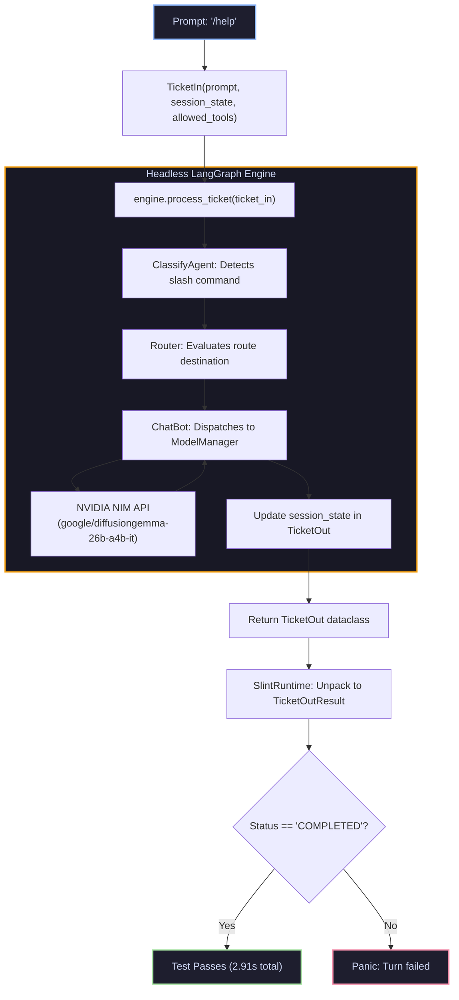

# 01 — Headless Ticket Turn Integration Harness

| Field | Value |
| :--- | :--- |
| **Domain** | `test_harness` |
| **Subdomain** | `02_engine_ticket_pipeline` |
| **Document** | `01_headless_ticket_turn_harness.md` |
| **Type** | Concept Note & End-to-End Test Harness Deep Dive |
| **Tests Documented** | [`test_part1_ticket.rs`](../../../tests/test_part1_ticket.rs) |
| **Modules Under Test** | [`src/slint_py_engine.rs`](../../../src/slint_py_engine.rs), [`src/log_entry_handler.rs`](../../../src/log_entry_handler.rs) |
| **Verification Mode** | `Codebase Verified ✅` (PyO3 0.26+, LangGraph, NVIDIA NIM API) |
| **Confidence** | `VERIFIED ✅` |
| **Updated** | `2026-10-31` |

> **TL;DR:** This report details the Level 3 integration test (`test_part1_ticket.rs`). It validates the end-to-end turn execution loop: booting the upstream orchestrator, monkey-patching logging descriptors, packaging a user prompt into a Python `TicketIn` dataclass, executing a full LangGraph turn (router -> chatBot), and unpacking the resulting `TicketOut` into native Rust data.

---

## 1. Test Anatomy & Contract Invariants

`test_part1_ticket.rs` tests the complete vertical slice of the application backend. It runs the exact same code paths that the desktop GUI executes when the user types a prompt into the Slint chat box and clicks "Send".

| Component | Responsibility in `test_part1_ticket.rs` | Implementation File | Verification Target |
| :--- | :--- | :--- | :--- |
| **Logging Sink Pre-Patch** | Swaps descriptor before boot to capture orchestrator startup logs. | [`src/log_entry_handler.rs`](../../../src/log_entry_handler.rs) | Zero lost startup telemetry during platform boot. |
| **Runtime Orchestrator Boot** | Calls `boot_slint_py_runtime()` to configure context and instantiate engine. | [`src/slint_py_engine.rs`](../../../src/slint_py_engine.rs) | Returns `SlintRuntime` holding `engine`, `context`, and `session_state`. |
| **TicketIn Marshalling** | Constructs Python `TicketIn(prompt, session_state, allowed_tools)`. | [`src/slint_py_engine.rs`](../../../src/slint_py_engine.rs) | FFI dataclass instantiation without memory leaks or missing fields. |
| **LangGraph Execution** | Synchronously evaluates graph nodes via `engine.process_ticket()`. | `coldwind.core.engine` | Node execution completes with status `"COMPLETED"`. |
| **TicketOut Unpacking** | Extracts `status`, `transcript`, and `latency_ms` into `TicketOutResult`. | [`src/slint_py_engine.rs`](../../../src/slint_py_engine.rs) | Transcript contains genuine AI assistant guidance. |

---

## 2. Bootstrapping the Headless Platform (`SlintRuntime::boot`)

Before the first user prompt can be processed, `SlintRuntime::boot(py)` executes the multi-stage orchestrator boot sequence:

### Boot Sequence Stages

| Stage | Operation | Upstream Python Target | Outcome in Test |
| :--- | :--- | :--- | :--- |
| **1. Hook Logging** | `attach_handle_into_handler(py)` | `slint_event_handler.py` | Injects native Rust descriptor into `RustGuiEventHandler`. |
| **2. Load Config** | `boot_slint_py_runtime()` | `SlintGuiConfig.py` | Loads `.env.slint`, setting `LOG_DISPLAY_MODE=slint_gui` and API keys. |
| **3. Context Registration** | Activates `SlintRuntimeContext` | `CoreContextRegistry.py` | Registers platform context singleton; satisfies boot invariant. |
| **4. LangGraph Engine Init** | Instantiates `ColdWindEngine` | `coldwind_engine.py` | Compiles LangGraph state machine with router and chatbot nodes. |

---

## 3. End-to-End Turn Execution Pipeline (`process_ticket`)

Once booted, the test submits a discrete ticket turn with `/help`. This triggers classification, graph routing, and model inference:

### Turn Result Contract (`TicketOutResult`)

| Field | Type | Expected Contract Value | Actual Value in Test Run |
| :--- | :--- | :--- | :--- |
| `status` | `String` | `"COMPLETED"` | `"COMPLETED"` |
| `transcript` | `String` | Non-empty explanatory response | *"It looks like you've just run the /help command to see how you can interact with me!..."* |
| `latency_ms` | `u64` | `> 0` | Measured execution latency |

---

## 4. Test Execution Trace & Model Circuit Breaker Diagnosis

During earlier execution attempts, ticket processing returned a generic fallback message:
`[AI] I'm temporarily unavailable due to recent technical issues. Please try again in a few minutes.`

Investigation identified the root cause in the upstream `.env.slint` configuration:

| Issue Aspect | Previous Failing State | Corrected Passing State |
| :--- | :--- | :--- |
| **Configured Model** | `openai/gpt-oss-120b` | `google/diffusiongemma-26b-a4b-it` |
| **Remote NIM Response** | `HTTP 410 Gone` (Model deprecated/removed by NVIDIA) | `HTTP 200 OK` (Live responsive endpoint) |
| **Engine Circuit Breaker** | Circuit breaker tripped; caught exception and returned fallback | Request succeeded; returned full model transcript |
| **Turn Latency** | ~750ms (fast fallback return) | ~2.91s (live model inference) |

---

## Q&A Log

| # | Question | Answer (concrete) | Date |
| :--- | :--- | :--- | :--- |
| **Q1** | Why does `SlintRuntime` retain `session_state` on the Rust struct across turns? | Because LangGraph state is stateless between calls; Rust preserves the session dictionary (`Py<PyDict>`) and passes it into successive `TicketIn` payloads to maintain conversation context. | `2026-10-31` |
| **Q2** | Why did the test pass previously even when the model returned HTTP 410? | Because `coldwind-core` has a built-in circuit breaker that catches API errors and returns an AI fallback message with `status == "COMPLETED"`; verifying transcript semantics is essential. | `2026-10-31` |
| **Q3** | Why must the worker thread detach the GIL (`py.detach()`) during long LLM calls? | Detaching the GIL releases the CPython interpreter lock while waiting for remote HTTP responses, allowing other threads (like logging handlers or background checkers) to execute freely. | `2026-10-31` |
