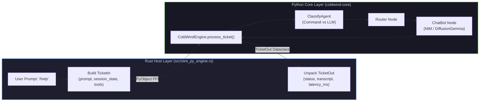

# 🚀 Subdomain 02: Engine Ticket Pipeline & LangGraph Turns

| Field | Value |
| :--- | :--- |
| **Domain** | `test_harness` |
| **Subdomain** | `02_engine_ticket_pipeline` |
| **Path** | [`reports/test_harness/02_engine_ticket_pipeline/`](./README.md) |
| **Type** | Subdomain Index & Architectural Overview |
| **Verification Mode** | `Codebase Verified ✅` (PyO3 0.26+, LangGraph, NVIDIA NIM API) |
| **Confidence** | `VERIFIED ✅` |
| **Total Test Targets** | 1 End-to-End Integration Test |
| **Updated** | `2026-10-31` |

> **TL;DR:** Subdomain 02 validates the top of the test pyramid: booting the headless Python orchestrator (`main_orchestrator.boot_slint_py_runtime`), executing discrete LangGraph turns via the `TicketIn` / `TicketOut` contract, managing conversation session state across turns, and validating live AI inference responses.

---

## 📺 Recommended Learning & Reference Sources

| # | Source & Link | Architectural Focus | Verification |
| :--- | :--- | :--- | :--- |
| **1** | [`../../tests/test_part1_ticket.rs`](../../../tests/test_part1_ticket.rs) | Level 3 end-to-end integration test executing `SlintRuntime::boot` and `process_ticket`. | `VERIFIED ✅` |
| **2** | [`../../../src/slint_py_engine.rs`](../../../src/slint_py_engine.rs) | Rust wrapper managing engine lifecycle, session state dictionary, and ticket marshalling. | `VERIFIED ✅` |
| **3** | [`/home/pirate/development/ai-workflow-task-agent/.env.slint`](file:///home/pirate/development/ai-workflow-task-agent/.env.slint) | Desktop GUI environment configuration (NVIDIA NIM API key, `GPT_MODEL`, logging flags). | `VERIFIED ✅` |
| **4** | [`../../cross-platform-docs/02_rust_driving_python/01-importing-and-calling-python.md`](../../cross-platform-docs/02_rust_driving_python/01-importing-and-calling-python.md) | Architectural foundations of executing Python classes and methods from Rust. | `VERIFIED ✅` |

---

## At a Glance & Navigation

| Document | Relative Path | Focus & Tests Documented | Status |
| :--- | :--- | :--- | :--- |
| **01 — Headless Ticket Turn Harness** | [`./01_headless_ticket_turn_harness.md`](./01_headless_ticket_turn_harness.md) | Detailed breakdown of `test_part1_ticket.rs` (Level 3), LangGraph routing, and NIM model execution. | `🟢 Complete` |
| **Parent Domain Index** | [`../README.md`](../README.md) | Root test harness domain index and test pyramid overview. | `🟢 Complete` |
| **Sibling Subdomain 01** | [`../01_environment_and_runtime/README.md`](../01_environment_and_runtime/README.md) | Environment setup, boot invariants, and in-memory log sinks. | `🟢 Complete` |

---

## Architectural Topology

The ticket pipeline converts high-level user text inputs into structured LangGraph agent turns and returns validated transcripts to the desktop GUI:

---

## Key Takeaways

| Pillar | Invariant Verified | Key Rust/Python Mechanism |
| :--- | :--- | :--- |
| **Discrete Turn Isolation** | Engine does not run infinite blocking CLI loops; it evaluates discrete request/response turns. | `ColdWindEngine.process_ticket(ticket_in)` called synchronously per turn. |
| **Stateful Session Continuity** | Chat history and tool state persist across turns without global mutable state in Python. | `session_state` PyDict is owned by Rust's `SlintRuntime` struct and passed on each turn. |
| **Descriptor Order Precedence** | Logging sinks must be patched before `boot_slint_py_runtime` is called. | `attach_handle_into_handler(py)` runs before orchestrator boot, capturing all boot events. |
| **Model Circuit Breaker Resilience** | Upstream engine falls back cleanly when model endpoints return HTTP errors. | Tested against live NIM endpoint (`google/diffusiongemma-26b-a4b-it`) returning valid responses in ~2.9s. |
