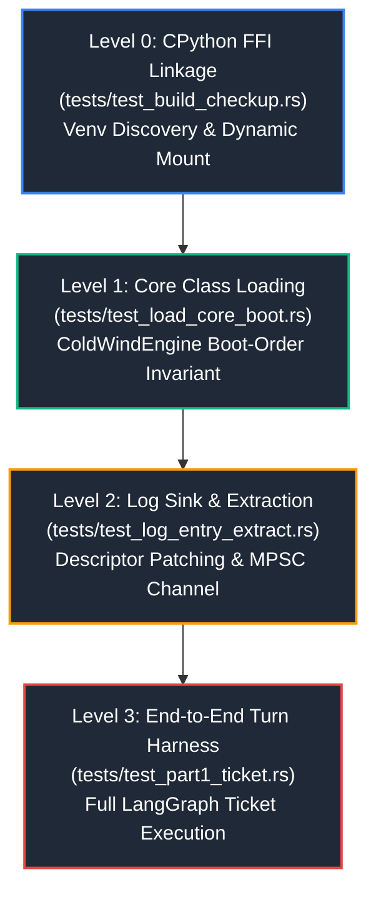

# 🧪 Domain: Test Harness & Verification Suite

| Field | Value |
| :--- | :--- |
| **Domain** | `test_harness` |
| **Path** | [`reports/test_harness/`](./README.md) |
| **Type** | Domain Hub & System Test Index |
| **Verification Mode** | `Codebase Verified ✅` (Rust 2024, PyO3 0.26+, CPython 3.14.7) |
| **Confidence** | `VERIFIED ✅` |
| **Total Test Targets** | 4 Integration Tests (`tests/*.rs`) |
| **Suite Pass Rate** | 100% (4 passed, 0 failed, 0 ignored) |
| **Updated** | `2026-10-31` |

> **TL;DR:** The `test_harness` domain documents the four-tier verification suite bridging the native Rust + Slint desktop GUI with the embedded Python 3.14 `coldwind-core` LangGraph engine. It defines the testing pyramid, environment validation, logging pipelines, and end-to-end ticket turn contracts.

---

## 1. Test Suite Architecture & The Verification Pyramid

Testing an embedded PyO3 desktop application presents unique challenges: Rust must initialize CPython, mount external virtual environments, monkey-patch logging sinks, and drive asynchronous agent workflows while preserving strict memory and thread safety boundaries.

The test suite is structured as a hierarchical pyramid of integration targets:

### The 4 Test Levels at a Glance

| Level | Test Binary | Source File | Architectural Responsibility | Execution Time |
| :--- | :--- | :--- | :--- | :--- |
| **Level 0** | `test_build_checkup` | [`../../tests/test_build_checkup.rs`](../../tests/test_build_checkup.rs) | CPython 3.14 runtime linkage, virtual environment path resolution, and `coldwind.core` dynamic import. | ~0.01s |
| **Level 1** | `test_load_core_boot` | [`../../tests/test_load_core_boot.rs`](../../tests/test_load_core_boot.rs) | `ColdWindEngine` class handle extraction and validation of the ContextRegistry fail-fast invariant. | ~0.99s |
| **Level 2** | `test_log_entry_extract` | [`../../tests/test_log_entry_extract.rs`](../../tests/test_log_entry_extract.rs) | Native PyO3 descriptor injection into `RustGuiEventHandler` and strongly-typed `LogEntry` deserialization. | ~0.15s |
| **Level 3** | `test_part1_ticket` | [`../../tests/test_part1_ticket.rs`](../../tests/test_part1_ticket.rs) | Full headless lifecycle: orchestrator boot, `.env.slint` loading, `TicketIn` submission, and `TicketOutResult` validation. | ~2.91s |

---

## 2. Sub-Domain Topology & Navigation

The test harness documentation is divided into two focused sub-domains based on architectural layer:

| Sub-Domain | Path | Focus Area | Documented Tests | Status |
| :--- | :--- | :--- | :--- | :--- |
| **01: Environment & Runtime** | [`./01_environment_and_runtime/README.md`](./01_environment_and_runtime/README.md) | CPython initialization, virtualenv injection, boot invariants, and in-memory log sinks. | `test_build_checkup.rs`, `test_load_core_boot.rs`, `test_log_entry_extract.rs` | `🟢 Complete` |
| **02: Engine Ticket Pipeline** | [`./02_engine_ticket_pipeline/README.md`](./02_engine_ticket_pipeline/README.md) | Orchestrator bootstrapping, `TicketIn`/`TicketOut` data contracts, LangGraph routing, and NIM model execution. | `test_part1_ticket.rs` | `🟢 Complete` |

---

## 3. Test Runner & Cargo Invariants

Every test file in `tests/*.rs` is compiled by Cargo as a discrete integration test binary linked against both the crate root library (`ai_workflow_gui`) and the PyO3 CPython runtime.

| Cargo Command | Execution Behavior | Output & Diagnostics |
| :--- | :--- | :--- |
| `cargo test` | Runs the full integration suite sequentially across all 4 targets. | Displays test status counts for lib, bin, and each test target. |
| `cargo test --test test_build_checkup` | Executes only Level 0 smoke test. | Fastest smoke check for CPython linking and venv paths. |
| `cargo test --test test_log_entry_extract -- --nocapture` | Runs Level 2 log extraction with stdout unbuffered. | Prints deserialized `LogEntry` payload, log level, and metadata presence. |
| `cargo test --test test_part1_ticket -- --nocapture` | Runs Level 3 end-to-end turn with live stdout. | Displays full LangGraph turn transcript, latency, and status. |

---

## 4. Key Takeaways & Best Practices

| Topic | Best Practice | Failure Consequence If Ignored |
| :--- | :--- | :--- |
| **Test Independence** | Each test file initializes its own Python attachment via `Python::attach(\|py\| ...)`. | Shared GIL state across concurrent tests can cause nondeterministic deadlocks. |
| **Logging Channel Isolation** | Tests requiring log extraction must invoke `init_sync_send_all()` before Python operations. | Late initialization causes Python debug calls to hit uninitialized channels or discard events. |
| **Fail-Fast Assertion** | Tests asserting error boundaries (e.g. `test_load_core_boot`) must assert `res.is_err()`. | Silent crashes or panic unwinding across the FFI boundary triggers undefined behavior. |
| **External Environment Pathing** | Paths to `.venv` are read at compile-time via `env!("COLDWIND_VENV")` set in `.cargo/config.toml`. | Hardcoded developer home paths cause test failures on foreign machines or CI/CD agents. |
