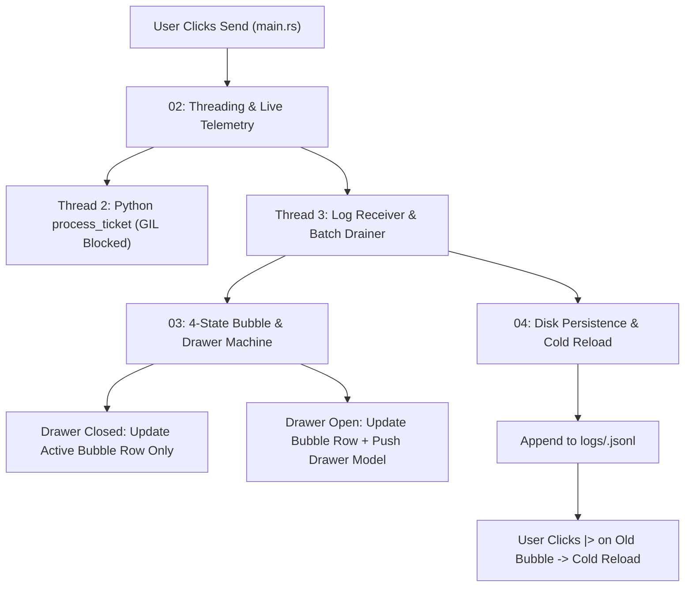

# Urgent Development — Slint GUI Telemetry & Modern UX Parity

## Domain

- **urgent_development** (Parent Domain) — High-priority architectural audits, critical concurrency hazard fixes, and platform parity blueprints.
- **01_slint_gui_telemetry_and_ux_parity** (Sub-domain) — Forensic analysis of architectural gaps between reference Desktop CLI and native Slint GUI, logging sink deadlocks, three-thread telemetry streaming, and the 75% slide-in inspector drawer.

---

## At a glance

| Document | Type | Focus / What it answers | Status |
| :--- | :--- | :--- | :---: |
| [`01_slint_gui_architecture_gap_and_telemetry_audit.md`](./01_slint_gui_architecture_gap_and_telemetry_audit.md) | Investigation & Gap Analysis | Forensically compares Desktop CLI vs Slint GUI, isolates 7 fatal gaps (deadlock, freezes, blank bubbles), and defines the 4-pillar parity blueprint. | 🟢 Active |
| [`02_threading_and_live_telemetry_pipeline.md`](./02_threading_and_live_telemetry_pipeline.md) | Design / Decision | Decouples GIL-blocked `process_ticket` from log consumption via Thread 3 (Telemetry Drainer), batch-draining logs for smooth 60 FPS in-place updates. | 🟢 Approved |
| [`03_bubble_and_drawer_state_machine.md`](./03_bubble_and_drawer_state_machine.md) | Design / Decision | **TIER 1 (RAM ONLY):** Governs in-flight live turns. Defines the 4-state matrix (`is_generating` × `drawer_open`) using volatile RAM `ActiveTurnBuffer` with zero disk I/O. | 🟢 Approved |
| [`04_disk_persistence_and_cold_reload.md`](./04_disk_persistence_and_cold_reload.md) | Design / Decision | **TIER 2 (DISK STORAGE):** Governs completed historical turns. Flushes finalized logs to append-only `logs/<id>.jsonl` for cold reloads without bloating RAM heap. | 🟢 Approved |

---

## Master Architecture Map

---

## Key takeaways

1. **Deadlock Hazard (Gap 1):** The logging bridge initializes `sync_channel::<LogEntry>(1024)`, but Thread 2 blocks on Python. Moving log ingestion into a dedicated **Thread 3** continuously drains the channel and prevents kernel futex hangs.
2. **Deterministic `ticket_id` Handoff:** Pre-calculating `ticket_id` on Thread 0 before dispatch guarantees that the UI Sentinel bubble, the Python worker, and Thread 3 share an identical lookup key from millisecond zero.
3. **In-Place Row Mutation:** Using `chat_model_rc.set_row_data(last_idx, updated_msg)` inside `invoke_from_event_loop` eliminates list flickering and avoids pushing duplicate AI bubbles.
4. **4-State Inspection Guard:** Checking `active_ticket.ticket_id == current_ticket_id` before routing logs to the drawer allows users to safely inspect historical turns without background streaming logs corrupting the view.
5. **Phased Pragmatism:** Prioritizes in-memory RAM telemetry (Thread 3 + Sentinel updates) and the 75% drawer component before building on-disk JSONL cold reload serialization.

---

## Reading path

1. Start with [`01_slint_gui_architecture_gap_and_telemetry_audit.md`](./01_slint_gui_architecture_gap_and_telemetry_audit.md) for the baseline audit and comparative gap matrix.
2. Study [`02_threading_and_live_telemetry_pipeline.md`](./02_threading_and_live_telemetry_pipeline.md) for the three-thread concurrency model.
3. Follow with [`03_bubble_and_drawer_state_machine.md`](./03_bubble_and_drawer_state_machine.md) to understand the drawer state permutations and active turn buffering.
4. Review [`04_disk_persistence_and_cold_reload.md`](./04_disk_persistence_and_cold_reload.md) for long-session disk persistence.
5. Inspect the HTML reference prototype at [`agent_workflow_inspector_prototype.html`](./agent_workflow_inspector_prototype.html).
6. Return to parent domain catalog at [`../README.md`](../README.md).
